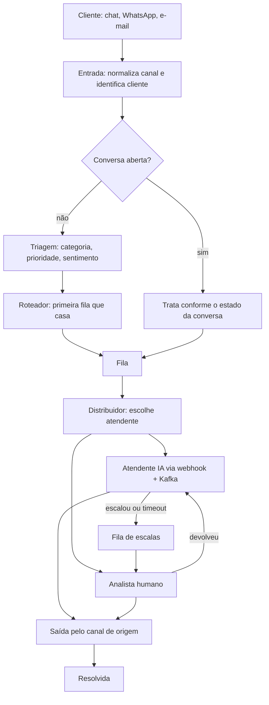
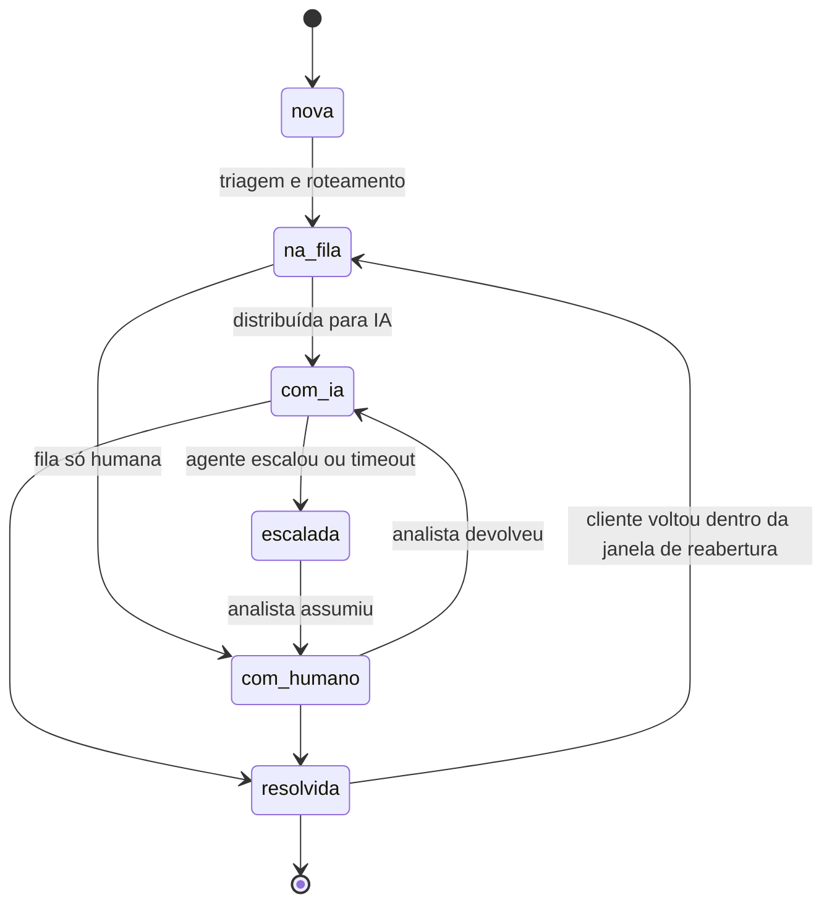
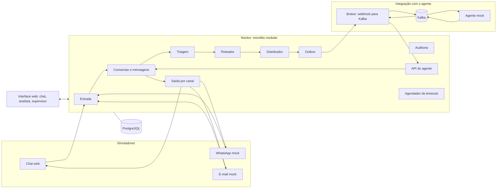

# Arquitetura: Help Desk AI First

Plataforma de help desk própria para a CloudWalk: multi-marca, multi-equipe, com o agente de IA atuando como atendente e o analista humano entrando por escalação.

Documento vivo. Cada decisão tem um status:
- **Decidida:** validada e fechada.
- **Proposta:** recomendação ainda a validar.

Referências completas em [`referencias.md`](referencias.md). Detalhe dos diferenciais em [`diferenciais.md`](diferenciais.md).

---

## 1. Problema

A CloudWalk (InfinitePay no Brasil, JIM nos EUA) atende milhões de lojistas por chat no app, WhatsApp e e-mail. Já tem um agente de IA que atende de ponta a ponta, integrado ao help desk por webhooks e Kafka. O help desk atual é de terceiros: lento, com defeitos recorrentes e sem espaço para a estrutura multi-marca e multi-equipe da operação.

**Entrega:** um help desk próprio que recebe o agente como atendente, distribui os atendimentos em filas configuráveis pela operação e faz handoff para humanos com contexto, aguentando o volume real com rastreabilidade de cada decisão.

**Fora de escopo (TAPI):** desenvolver o agente de IA, dados reais, integração com sistemas de produção, apps móveis.

## 2. Requisitos

**Funcionais**
1. Receber mensagens de chat, WhatsApp e e-mail (simulados).
2. Filas múltiplas, configuráveis e editáveis pela operação, sem deploy.
3. Triagem, priorização e distribuição entre IA e humanos.
4. Integração com o agente (mock) por webhook + broker, no formato da estrutura atual.
5. Interface de conversa entre cliente e atendente.
6. Painel do analista com fila de escalas, contexto e histórico.
7. Handoff com resumo, preservando o histórico.
8. Auditoria de cada decisão de atendimento e de escala.
9. Memória e contexto entre interações.

**Não funcionais**
- Volume de referência com estabilidade, inclusive em picos.
- Robustez diante de falhas, reentregas e picos.
- Rastreabilidade de cada mensagem, decisão e escala.
- Self-hosted (Docker). LGPD: só dados sintéticos.

**Restrições do projeto:** individual, 1 mês, entrega com plataforma + experimento técnico + README.

## 3. Premissas de volume (decidida)

| | Base | Estresse |
|---|---|---|
| Atendimentos por dia | 10.000 | 50.000 |
| Mensagens por dia (12 por atendimento) | 120.000 | 600.000 |
| Média | ~1,4 msg/s | ~7 msg/s |
| Pico (5x) | ~7 msg/s | ~35 msg/s |
| Pico com concentração em horário comercial | ~14 msg/s | ~70 msg/s |
| **Meta do teste de carga** | | **100 msg/s** |

**De onde vêm os números**
- 10 mil/dia: em 2023 a IA fez 75% dos atendimentos da InfinitePay, cerca de 2,6 milhões. Total ≈ 3,5 milhões/ano ≈ 9,5 mil/dia. *Dado público.*
- 50 mil/dia: a base de clientes foi de ~1,2 milhão (2023) para 6,3 milhões. Extrapolação linear. *Premissa.*
- 12 mensagens por atendimento e pico de 5x. *Premissas.*

**Conversas simultâneas (Lei de Little):** 2,9 chegadas/s no pico × 420 s de duração média (tempo divulgado do Claudio Walker) ≈ **1.200 conversas abertas ao mesmo tempo**.

**Conclusão:** o volume é baixo para Postgres e Kafka. **O desafio do sistema não é throughput, é confiabilidade** (não perder nem duplicar mensagens, aguentar falha e reentrega) **e estado** (manter ~1.200 conversas com fila, contexto e histórico corretos). A arquitetura concentra o esforço aí.

## 4. Perfis de usuário (decidida)

| Perfil | Origem | O que faz |
|---|---|---|
| Lojista | TAPI | Abre a solicitação por chat, WhatsApp ou e-mail |
| Agente de IA | TAPI | Atende como um usuário da plataforma; responde, executa ou escala |
| Analista humano | TAPI | Recebe escalas, assume ou apoia casos complexos |
| Supervisor de operação | **Adição nossa** | Configura filas, acompanha a saúde da operação |

O supervisor não está no TAPI. Foi deduzido do requisito "configurável pela operação": alguém precisa ser dono da configuração.

## 5. Princípios da arquitetura (decidida)

1. **Conversa com estado, não esteira.** O cliente manda várias mensagens. Cada uma é tratada conforme o estado atual da conversa.
2. **A IA é um atendente, não uma etapa.** Ela fica dentro das filas, como um humano. Algumas filas podem ir direto para humanos.
3. **Escalar é voltar para o sistema de filas**, com `origem = escalado` e prioridade maior. O humano pode devolver para a IA.
4. **Confiabilidade antes de escala:** idempotência, retentativa, ordem por conversa e fila de erros.
5. **Tudo vira evento registrado.** A auditoria é uma camada transversal, não uma etapa.
6. **Regras são dados, não código.** Filas e personas ficam no banco e são editadas pela interface.
7. **Monólito modular.** Um núcleo com módulos bem separados; só sai do núcleo o que precisa escalar ou falhar de forma independente.

## 6. Engenharia reversa (decidida)

| De onde | O que pegamos |
|---|---|
| Chatwoot | Bot como atendente; handoff por status (bot → humano → bot) |
| Zendesk | Fila = condições + ordem + prioridade; primeira fila que casa leva; fila padrão como fallback |
| CloudWalk (TAPI) | Kafka entre plataforma e agente, alimentado por webhooks |
| **Onde melhoramos** | O Chatwoot não refaz webhooks que falham e joga a conversa para humano. Aqui: outbox, retentativa, idempotência e fila de erros |

## 7. Fluxo de uma mensagem



Toda seta gera um evento no log de auditoria.

## 8. Estados da conversa (proposta)



- **Memória entre interações:** se o cliente volta dentro da janela (ex.: 24 h), a conversa reabre. Depois disso, abre uma nova, mas o agente recebe o resumo das últimas conversas desse cliente.
- **Timeout:** se o agente não responde em N segundos, a conversa vai para `escalada` com motivo `timeout_agente`.

## 9. Componentes (proposta)



| Componente | Responsabilidade |
|---|---|
| **Simuladores de canal** | Geram mensagens sintéticas de chat, WhatsApp e e-mail; recebem as respostas |
| **Entrada** | Normaliza o formato do canal, identifica o cliente, abre ou encontra a conversa |
| **Triagem** | Preenche categoria, prioridade e sentimento. Começa com regras; um modelo pequeno é evolução |
| **Roteador** | **Função pura**: atendimento + regras → fila. Testa as filas em ordem; fallback na fila padrão |
| **Distribuidor** | Escolhe o atendente (IA ou humano) por capacidade, habilidade e prioridade |
| **Conversas e mensagens** | Dono do estado da conversa e do histórico |
| **Auditoria** | Log append-only de todos os eventos |
| **Outbox** | Garante que nenhum evento para fora se perca (detalhe na seção 11) |
| **Broker** | Serviço separado, espelhando a estrutura atual: recebe webhooks da plataforma, publica no Kafka, consome as respostas e chama a API do agente |
| **Agente mock** | Consome do Kafka e responde. Determinístico por padrão; LLM aberto opcional, registrando modelo e versão |
| **API do agente** | Recebe os eventos do agente (resposta, ação, escala, resolução). Idempotente |
| **Saída por canal** | Devolve a resposta pelo canal de origem |
| **Agendador de timeouts** | Escala conversas paradas além do limite (agente sem resposta, SLA estourando) |
| **Interface web** | Chat do cliente, painel do analista, configuração de filas do supervisor |

**Ficam fora do núcleo:** o broker e o agente mock, porque espelham a fronteira real com o agente da CloudWalk e precisam falhar de forma independente (o experimento derruba os dois de propósito).

## 10. Contrato com o agente (decidida)

JSON com JSON Schema por tipo de evento e versionamento.

**Plataforma → agente**

| Evento | Quando |
|---|---|
| `conversa.atribuida` | Conversa caiu para a IA. Leva cliente, marca, fila, histórico e persona da marca |
| `mensagem.recebida` | Nova mensagem do cliente |
| `conversa.devolvida` | Humano devolveu para a IA |
| `conversa.encerrada` | Conversa fechou; o agente pode liberar o estado |

**Agente → plataforma**

| Evento | Quando |
|---|---|
| `mensagem.enviada` | Resposta ao cliente |
| `acao.executada` | Ação executada (mock). Vai para a auditoria |
| `conversa.escalada` | Pedido de handoff com motivo, resumo e prioridade sugerida |
| `conversa.resolvida` | Caso encerrado pelo agente |

**Envelope comum**

```json
{
  "versao": "1.0",
  "id_evento": "evt_8f2a...",
  "tipo": "conversa.escalada",
  "id_conversa": "conv_123",
  "id_atribuicao": "atr_41",
  "causado_por": "evt_77c1...",
  "marca": "infinitepay",
  "timestamp": "2026-11-17T13:30:00-03:00",
  "dados": {
    "motivo": "cliente_irritado",
    "resumo": "Repasse de ontem não caiu; cliente já tentou 2 vezes.",
    "prioridade_sugerida": "alta"
  }
}
```

- `id_evento`: idempotência.
- `id_conversa`: chave de partição no Kafka. Garante ordem dentro da conversa.
- `id_atribuicao`: qual atribuição da conversa o evento se refere. Evento com atribuição vencida é descartado (seção 11.2).
- `causado_por`: `id_evento` que originou este. Permite id determinístico em eventos derivados (seção 11.1). Nulo quando o evento nasce de uma ação do cliente.

Os dois últimos campos entram já na fatia 1, mesmo sem uso, para não exigir nova versão do contrato depois.

**Tópicos Kafka (proposta)**
- `helpdesk.para-agente`
- `agente.para-helpdesk`
- `helpdesk.erros` (fila de erros, *dead letter*)

## 11. Confiabilidade e consistência (proposta)

É o centro da avaliação ("robustez diante de falhas, reentregas e picos"). Cada decisão abaixo responde a uma falha que o próprio experimento provoca (seção 16): evento duplicado, agente lento ou fora do ar, broker fora do ar, pico.

Garantia buscada: **entrega pelo menos uma vez + processamento idempotente em cada consumidor = efeito de exatamente uma vez.** Mesmo princípio do exactly-once do Kafka (escrita idempotente e transacional; Wang et al., SIGMOD 2021).

### 11.1 Causalidade e idempotência em cada consumidor

**Falha que evita:** `mensagem.recebida` chega duas vezes, o agente responde duas vezes com `id_evento` diferentes e o cliente recebe a resposta em dobro. Deduplicar só por `id_evento` no núcleo não pega esse caso.

**Decisão**
- Evento derivado tem id determinístico: `uuid5(causado_por, tipo, sequencia)`. Reprocessar a mesma entrada gera o mesmo id.
- Cada consumidor (núcleo, broker, agente mock, saída por canal) tem a sua inbox: `eventos_processados(consumidor, id_evento)` com chave única, gravada na mesma transação do efeito.
- O offset do Kafka só é confirmado depois dessa transação.
- A saída por canal também passa pela outbox. Enviar ao WhatsApp ou e-mail é efeito externo como qualquer outro.

**Base**
- Saltzer, Reed e Clark (1984): detecção de duplicata é uma das funções que só fica completa nas pontas; a camada do meio ajuda, mas não garante.
- Helland (2012): em sistema distribuído a mensagem é reenviada, então a operação precisa ter o mesmo efeito se executada mais de uma vez.
- Richardson (outbox): o relay pode publicar a mesma mensagem mais de uma vez se cair entre publicar e marcar; quem consome precisa deduplicar.

### 11.2 Caminho único de escrita da conversa

**Falha que evita:** a resposta da IA chega depois do timeout e cai no meio do atendimento humano; duas transições simultâneas e uma apaga a outra; dois workers passam da capacidade de um analista; duas conversas abertas para o mesmo cliente.

**Decisão:** toda mudança de estado passa por `transicionar(conversa, para, ator, id_atribuicao)`, numa transação só:
1. `SELECT ... FOR UPDATE` na conversa;
2. valida a transição em `transicoes_permitidas`;
3. fencing: evento com `id_atribuicao` diferente do atual é descartado e auditado;
4. ao atribuir a um atendente, trava a linha dele e confere a capacidade;
5. grava o estado, o evento de auditoria e a outbox.

Complemento: índice único parcial em `conversas(id_cliente, marca)` enquanto a conversa não está resolvida, com upsert na entrada.

**Base**
- Bailis et al. (SIGMOD 2015): em 67 aplicações Rails, validações feitas só na aplicação (como unicidade) geraram duplicatas sob concorrência. Integridade precisa ficar no banco.
- Warszawski e Bailis (SIGMOD 2017): anomalias de concorrência em aplicações web com banco viraram ataques reais; 22 ataques críticos em 12 aplicações de e-commerce.
- Gray e Cheriton (SOSP 1989): direito com prazo (lease) como mecanismo tolerante a falhas. Kleppmann (2016): o recurso deve recusar escrita com token mais antigo. O `id_atribuicao` é esse token.

### 11.3 Ordem e falha por conversa

**Falha que evita:** retentativa com backoff deixa um evento posterior da mesma conversa sair antes; evento que sempre falha trava a partição; fila de erros esconde perda.

**Decisão**
- Outbox com `id_conversa` e `sequencia`. O relay só envia um evento se não houver anterior pendente da mesma conversa.
- Retentativas limitadas, com backoff exponencial, teto e jitter.
- Esgotou: vai para `helpdesk.erros` e a conversa é escalada para humano com motivo `falha_integracao`. Nenhum cliente fica sem resposta por erro técnico.
- Evento que falha no JSON Schema vai direto para `helpdesk.erros`.
- Fila de erros com métrica, alerta e endpoint de reprocessamento.

**Base**
- Yuan et al. (OSDI 2014): 92% das falhas catastróficas estudadas em Cassandra, HBase, HDFS, MapReduce e Redis vieram de tratamento errado de erros não fatais já sinalizados. O caminho de erro é onde o sistema quebra.
- AWS Builders' Library: backoff exponencial com teto e jitter; retentar chamada com efeito colateral só é seguro com idempotência.

### 11.4 Fronteira com o broker

**Falha que evita:** o broker perde mensagem em silêncio entre o webhook e o Kafka, ou entre o Kafka e o núcleo.

**Decisão**
- O broker só responde 2xx ao webhook depois do ack do Kafka (`acks=all`, produtor idempotente).
- O broker só confirma o offset de `agente.para-helpdesk` depois do 2xx do núcleo. Com o núcleo fora, o broker para de consumir e o Kafka segura as mensagens: contrapressão, não perda.

**Base:** Wang et al. (SIGMOD 2021); Saltzer, Reed e Clark (1984).

### 11.5 Agendador único

**Falha que evita:** timeout, SLA e outras ações com prazo implementadas cada uma num lugar, com valores e checagens diferentes.

**Decisão:** tabela `agendamentos(tipo, id_conversa, executar_em, status)`, consumida por um worker com `SKIP LOCKED`, que chama `transicionar`. Nesta versão: timeout do agente e SLA. Agregação de mensagens seguidas e envelhecimento de prioridade reaproveitam a mesma peça, como evolução (seção 20).

**Base:** Dai et al. (IC2E 2018) estudam bugs de timeout em sistemas servidores na nuvem e apontam valor de timeout errado e checagem de timeout ausente como as causas dominantes. Um ponto só para prazos reduz esses dois erros.

### 11.6 Reconciliador

**Falha que evita:** "zero mensagens perdidas" sem verificação é só uma afirmação, inclusive no experimento.

**Decisão:** job periódico que confere invariantes:
- toda mensagem de cliente tem resposta, escala ou ainda está no prazo;
- nenhum evento pendente na outbox além de N segundos;
- nenhuma conversa atribuída a atendente inexistente ou fora de capacidade;
- nenhuma resposta duplicada (mesmo `causado_por` e `tipo`).

Violação gera alerta, métrica e evento de auditoria. No experimento, é o juiz que conta perdas e duplicatas.

**Base**
- Saltzer, Reed e Clark (1984): a verificação que garante o resultado é a de ponta a ponta.
- Basiri et al. (IEEE Software 2016): experimentar com falhas em sistema distribuído exige uma medida contínua do comportamento normal para comparar antes e depois.

### 11.7 Resumo

| Risco | Decisão |
|---|---|
| Plataforma salva a conversa e cai antes de avisar o agente | Outbox transacional (11.2) |
| Evento duplicado em qualquer salto | Inbox por consumidor + id determinístico (11.1) |
| Resposta atrasada depois de timeout ou troca de dono | Fencing por `id_atribuicao` (11.2) |
| Transições ou atribuições concorrentes | `transicionar` com trava e capacidade (11.2) |
| Mensagens da mesma conversa fora de ordem | Partição por `id_conversa` + ordem na outbox (11.3) |
| Evento que sempre falha | Retentativa limitada, fila de erros, escala para humano (11.3) |
| Broker cai ou núcleo cai | Ack só depois do Kafka; offset só depois do núcleo (11.4) |
| Agente não responde | Agendador escala com `timeout_agente` (11.5) |
| Perda que ninguém vê | Reconciliador (11.6) |
| Pico de volume | Kafka absorve; workers consomem no ritmo que aguentam |

## 12. Filas e distribuição

**Fila (decidida):** regra de entrada + ordem interna + quem atende.

```json
{
  "nome": "JIM - Crédito Urgente",
  "ordem": 1,
  "prioridade": "alta",
  "condicoes": {
    "todas": [
      { "campo": "marca", "operador": "igual", "valor": "JIM" },
      { "campo": "categoria", "operador": "igual", "valor": "credito" }
    ]
  },
  "atendentes": ["agente_ia", "time_credito_us"]
}
```

**Campos das condições (decidida):** `marca`, `canal`, `categoria`, `prioridade`, `idioma`, `segmento_cliente`, `sentimento`, `origem`.
**Operadores:** `igual`, `diferente`, `em`. **Combinação:** `todas` ou `qualquer`.

**Roteamento (decidida):** filas testadas em ordem; a primeira que casa leva; sem match vai para a fila padrão (modelo Zendesk).

**Ordem dentro da fila (proposta):** prioridade primeiro, depois tempo de espera. O **envelhecimento** (prioridade efetiva crescendo com o tempo na fila) fica como evolução (seção 20).

**Distribuição (proposta):** cada atendente tem capacidade (humano: ex. 3 conversas simultâneas; IA: limite configurável por custo). Quando um atendente cobre várias filas, pega primeiro da fila de maior prioridade. A IA é um atendente cadastrado como qualquer outro, com `tipo = ia`.

**Handoff:** o evento `conversa.escalada` traz motivo e resumo. A conversa entra na fila de escalas com o histórico completo. O analista não pergunta de novo o que o cliente já contou.

**Gatilhos de escala (proposta):** pedido do agente, pedido explícito do cliente, sentimento negativo (cedo, antes de piorar; estudo de campo do Alibaba), timeout do agente, falha de integração (seção 11.3).

**Resumo de reserva (proposta):** quando a escala vem de timeout ou falha, não há resumo do agente. A plataforma monta um com os campos da triagem e as últimas N mensagens.

**Configuração segura (proposta):** editar sem deploy também permite quebrar sem deploy.
- Cada edição de filas gera uma versão nova e imutável. Ativar é atômico; rollback é reativar a versão anterior.
- Antes de ativar, validação: toda condição usa campo e operador conhecidos e existe fila padrão.
- Cada conversa guarda a versão de regras com que foi roteada. A auditoria responde "por que este atendimento foi para esta fila".
- `marca` em todas as tabelas e consultas, com teste automatizado que tenta ler dados de outra marca.

**Base:** Tang et al. (SOSP 2015) descrevem erro de configuração como uma das principais causas de queda no Facebook, por causa da frequência de mudanças e do erro humano; a resposta foi configuração versionada, validação automática de invariantes e revisão.

## 13. Modelo de dados (proposta)

| Entidade | Campos principais |
|---|---|
| `marcas` | id, nome, idioma padrão |
| `personas` | marca, tom, nome do atendente, mensagem de handoff, limites de ação, versão |
| `equipes` | marca, nome |
| `atendentes` | tipo (humano ou ia), equipe, habilidades, capacidade, status |
| `clientes` | marca, nome sintético, segmento |
| `identidades` | cliente, canal, identificador (telefone, e-mail, id do app) |
| `conversas` | cliente, marca, canal, estado, categoria, prioridade, sentimento, fila, atendente, id_atribuicao_atual, versao, versao_regras |
| `mensagens` | conversa, autor, conteúdo, canal, timestamp |
| `versoes_regras` | número, filas (JSONB), ativa, criada_por, criada_em. Imutável |
| `filas` | nome, ordem, prioridade, condições (JSONB), atendentes, ativa, versão |
| `atribuicoes` | id_atribuicao, conversa, fila, atendente, início, fim, motivo |
| `transicoes_permitidas` | estado de origem, estado de destino, quem pode disparar |
| `escalas` | conversa, motivo, resumo, prioridade |
| `eventos` | log de auditoria: id_evento, tipo, ator, conversa, payload, timestamp |
| `eventos_processados` | (consumidor, id_evento) único: inbox de cada consumidor |
| `outbox` | evento, destino, id_conversa, sequencia, tentativas, próxima_tentativa, status |
| `agendamentos` | tipo, conversa, executar_em, status |

Um cliente pode ter várias identidades (o mesmo lojista no WhatsApp e no e-mail). É isso que permite a memória entre canais.

**Fusão de identidades (proposta):** só com evidência forte, como login no app ou telefone verificado. Sem ela, os clientes ficam separados. Fundir errado mostra o histórico de um lojista para outro.

## 14. Stack (proposta)

| Camada | Escolha | Por quê |
|---|---|---|
| Núcleo | **Python + FastAPI** | Domínio do desenvolvedor; prazo de 1 mês; async nativo |
| Workers | Python (consumidores Kafka + processador da outbox) | Mesma linguagem do núcleo |
| Banco | **PostgreSQL** | Sugerido no TAPI; JSONB para as condições das filas; transação para a outbox |
| Broker | **Redpanda** | API compatível com Kafka (fiel à estrutura atual), um binário só, sobe fácil no Docker |
| Interface | **Next.js + React** | Sugerido no TAPI; WebSocket para atualização ao vivo |
| Testes | pytest | |
| Carga | k6 ou Locust | Gera o tráfego do experimento |
| Observabilidade | Logs estruturados com `id_conversa` + Prometheus e Grafana | Rastrear uma conversa de ponta a ponta e medir o experimento |
| Empacotamento | Docker Compose | Self-hosted, reprodutível com um comando |
| Análise | pandas + Plotly | Resultados do experimento |

**Python ou Ruby (decidida: Python).** A CloudWalk usa Ruby, e o Chatwoot (nossa referência) é Rails + Sidekiq. Ruby ganharia em aderência ao parceiro. Python ganha em velocidade de entrega, porque é a linguagem que o desenvolvedor domina, e o prazo é de 1 mês. Construímos e testamos em Python; migrar componentes para Ruby fica como possibilidade de evolução.

**O que mantém a migração possível:** os componentes só conversam por contratos que não dependem de linguagem (HTTP, Kafka e JSON Schema). Isso permite trocar um componente por vez, por exemplo o núcleo, sem reescrever o broker nem o agente mock.

## 15. Métricas

**Técnicas (experimento)**
- Latência interna (mensagem entra → evento chega ao agente) p50, p95, p99
- Latência ponta a ponta (mensagem do cliente → resposta no canal), com o tempo do agente simulado
- Throughput sustentado (msg/s)
- Mensagens perdidas (meta: 0)
- Processamentos duplicados (meta: 0)
- Tempo de recuperação depois de uma falha
- Atraso do consumidor no Kafka (*consumer lag*)

**Operacionais (painel)**
- Tempo de espera por fila
- Taxa de resolução pela IA
- Taxa de escalonamento e tempo até o handoff
- SLA cumprido por fila
- Taxa de reabertura

## 16. Experimento técnico (proposta)

**Por que comparativo:** Postgres e Redpanda sustentam 100 msg/s numa máquina local sem esforço, então "aguentou a carga" prova pouco. O que precisa ser provado é que cada decisão da seção 11 evita uma falha real.

**Hipótese:** sob a mesma carga e as mesmas falhas injetadas, a versão robusta tem zero mensagens perdidas e zero respostas duplicadas, e a versão ingênua não. A versão robusta mantém p95 de latência interna abaixo de 500 ms a 100 msg/s.

**Versões comparadas**
- **Ingênua:** a fatia 1. Publica direto no Kafka, sem outbox, inbox nem fencing.
- **Robusta:** a plataforma depois da fatia 3, com tudo da seção 11.

**Método**
1. Gerar carga crescente com k6 até 100 msg/s, com um pico de 5x por alguns minutos.
2. Injetar as mesmas falhas nas duas versões: derrubar o agente mock, derrubar o broker, derrubar o núcleo no meio de uma transação, reenviar eventos duplicados, atrasar o agente além do timeout.
3. O reconciliador (seção 11.6) conta perdas, duplicatas e respostas fora de dono em cada versão.
4. Medir latência, throughput, atraso do consumidor e tempo de recuperação.

**Resultado esperado:** uma tabela por falha injetada, com perdas e duplicatas nas duas versões. Cada linha liga uma decisão de arquitetura a uma falha que ela evita.

**Base:** Basiri et al. (IEEE Software 2016), experimentação com falhas injetadas e medida de estado estável; Yuan et al. (OSDI 2014), testar o caminho de erro.

**Limitações já conhecidas:** ambiente local, não produção; agente mock com latência simulada; dados sintéticos; premissas de 12 mensagens e pico de 5x; a versão ingênua é construída por nós, então representa um sistema sem essas proteções, não o help desk atual da CloudWalk.

**Alternativa ou complemento:** avaliação da distribuição de filas com o simulador de regras (D3).

## 17. Diferenciais (fase 2)

| # | Diferencial | Esforço |
|---|---|---|
| D1 | Persona da IA por marca | Pequeno |
| D2 | Fila de qualidade | Pequeno/médio |
| D3 | Simulador de regras de fila | Médio |
| D4 | Painel ao vivo do supervisor | Médio |
| D5 | Copiloto do analista | Médio |

Três decisões do núcleo deixam os diferenciais baratos: log de eventos (D2, D3, D4), roteador como função pura (D3) e contrato versionado (D5). Detalhes em [`diferenciais.md`](diferenciais.md).

## 18. Plano de construção (proposta)

Fatias verticais: cada uma funciona de ponta a ponta antes da próxima.

1. **Esqueleto:** Docker Compose com Postgres, Redpanda, núcleo e agente mock. Uma mensagem de chat vai e volta. O envelope já leva `id_atribuicao` e `causado_por`. Esta versão vira a versão ingênua do experimento.
2. **Confiabilidade A:** `transicionar` (11.2), outbox e inbox por consumidor (11.1), regras do broker (11.4).
3. **Confiabilidade B:** agendador com timeout e SLA (11.5), ordem e fila de erros com escala (11.3), reconciliador (11.6).
4. **Filas:** roteador, distribuidor, configuração versionada pela interface.
5. **Humano:** handoff, painel do analista, devolução para a IA.
6. **Canais e memória:** WhatsApp e e-mail simulados, identidades, reabertura.
7. **Experimento:** carga, injeção de falhas, comparação ingênua × robusta.
8. **Diferenciais** escolhidos na fase 2.
9. **README e demonstração.**

## 19. Decisões

| # | Decisão | Status |
|---|---|---|
| 1 | Volume base 10 mil/dia, estresse 50 mil/dia, meta de 100 msg/s | Decidida |
| 2 | Gargalo é confiabilidade e estado, não throughput | Decidida |
| 3 | Supervisor como quarta persona | Decidida |
| 4 | Conversa como máquina de estados | Decidida |
| 5 | IA como atendente dentro das filas | Decidida |
| 6 | Filas no modelo Zendesk (condições, ordem, prioridade, fallback) | Decidida |
| 7 | Contrato JSON com schema e versão; Kafka particionado por conversa | Decidida |
| 8 | Monólito modular; broker e agente mock fora do núcleo | Proposta |
| 9 | Outbox + idempotência + fila de erros | Proposta |
| 10 | Envelhecimento de prioridade na fila | Evolução (seção 20) |
| 11 | Python + FastAPI, Postgres, Redpanda, Next.js (Ruby como migração futura) | Decidida |
| 12 | Experimento comparativo ingênua × robusta (zero perda e duplicata só na robusta; p95 < 500 ms a 100 msg/s) | Proposta |
| 13 | Envelope com `id_atribuicao` e `causado_por` desde a fatia 1 | Proposta |
| 14 | Inbox por consumidor e id determinístico em eventos derivados | Proposta |
| 15 | Caminho único de escrita (`transicionar`) com trava, transições permitidas e fencing | Proposta |
| 16 | Ordem por conversa na outbox; retentativa limitada; fila de erros escala para humano | Proposta |
| 17 | Broker confirma só depois do Kafka e do núcleo | Proposta |
| 18 | Agendador único para prazos | Proposta |
| 19 | Reconciliador de invariantes | Proposta |
| 20 | Regras de fila versionadas, com validação e rollback | Proposta |

## 20. Evolução

Fica fora do mês, salvo sobra de tempo. Entra nas limitações do README.

| Item | Por que ficou para depois |
|---|---|
| Agregação de mensagens seguidas antes de despachar ao agente | Ganho de produto, não de robustez. Reaproveita o agendador |
| Envelhecimento de prioridade | Reaproveita o agendador; no volume de referência a fila raramente envelhece |
| Row-Level Security por marca no Postgres | O filtro por `marca` com teste cobre o mês; RLS é a defesa em profundidade |
| Tela de fusão de identidades para o analista | A regra conservadora (seção 13) já evita o vazamento |
| Tela de reprocessamento da fila de erros | O endpoint basta para o experimento |
| Triagem com classificador próprio e abstenção calibrada | Em discussão. Ideia: regressão logística sobre TF-IDF, faixas de confiança e fila de triagem humana; regras como plano B (Mozannar e Sontag, ICML 2020) |
