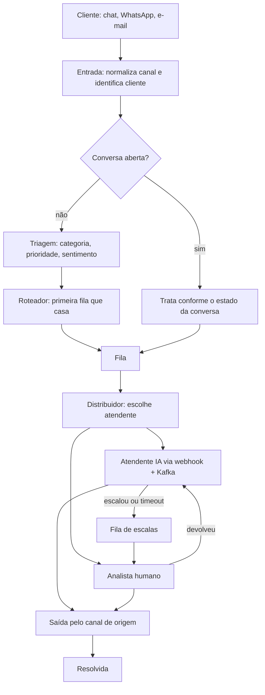
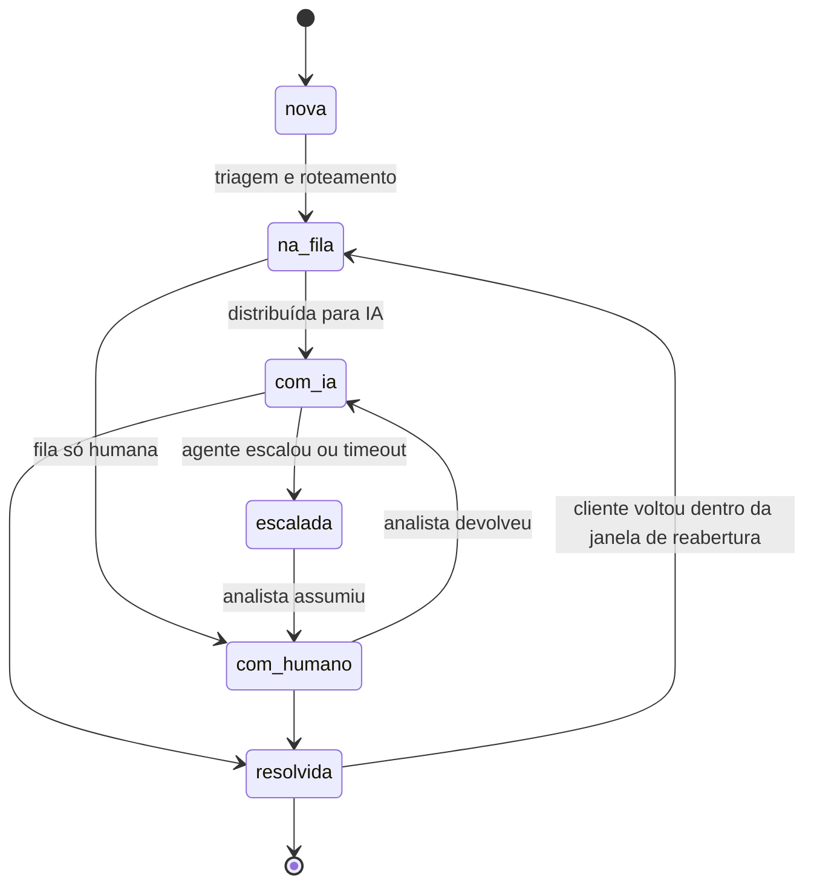
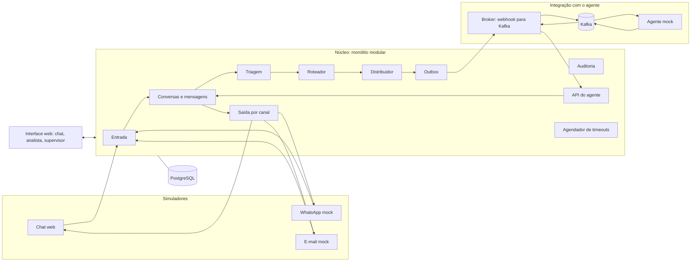

# Arquitetura: Help Desk AI First

Plataforma de help desk própria para a CloudWalk: multi-marca, multi-equipe, com o agente de IA atuando como atendente e o analista humano entrando por escalação.

Documento vivo. Cada decisão tem um status:
- **Decidida:** validada e fechada.
- **Proposta:** recomendação ainda a validar.

Referências completas em [`referencias.md`](referencias.md). Detalhe dos diferenciais em [`diferenciais.md`](diferenciais.md).

---

## 1. Problema

A CloudWalk (InfinitePay no Brasil, JIM nos EUA) atende milhões de lojistas por chat no app, WhatsApp e e-mail. Já tem um agente de IA que atende de ponta a ponta, integrado ao help desk por webhooks e Kafka. O help desk atual é de terceiros: lento, com defeitos recorrentes e sem espaço para a estrutura multi-marca e multi-equipe da operação.

**Entrega:** um help desk próprio que recebe o agente como atendente, distribui os atendimentos em filas configuráveis pela operação e faz handoff para humanos com contexto, aguentando o volume real com rastreabilidade de cada decisão.

**Fora de escopo (TAPI):** desenvolver o agente de IA, dados reais, integração com sistemas de produção, apps móveis.

## 2. Requisitos

**Funcionais**
1. Receber mensagens de chat, WhatsApp e e-mail (simulados).
2. Filas múltiplas, configuráveis e editáveis pela operação, sem deploy.
3. Triagem, priorização e distribuição entre IA e humanos.
4. Integração com o agente (mock) por webhook + broker, no formato da estrutura atual.
5. Interface de conversa entre cliente e atendente.
6. Painel do analista com fila de escalas, contexto e histórico.
7. Handoff com resumo, preservando o histórico.
8. Auditoria de cada decisão de atendimento e de escala.
9. Memória e contexto entre interações.

**Não funcionais**
- Volume de referência com estabilidade, inclusive em picos.
- Robustez diante de falhas, reentregas e picos.
- Rastreabilidade de cada mensagem, decisão e escala.
- Self-hosted (Docker). LGPD: só dados sintéticos.

**Restrições do projeto:** individual, 1 mês, entrega com plataforma + experimento técnico + README.

## 3. Premissas de volume (decidida)

| | Base | Estresse |
|---|---|---|
| Atendimentos por dia | 10.000 | 50.000 |
| Mensagens por dia (12 por atendimento) | 120.000 | 600.000 |
| Média | ~1,4 msg/s | ~7 msg/s |
| Pico (5x) | ~7 msg/s | ~35 msg/s |
| Pico com concentração em horário comercial | ~14 msg/s | ~70 msg/s |
| **Meta do teste de carga** | | **100 msg/s** |

**De onde vêm os números**
- 10 mil/dia: em 2023 a IA fez 75% dos atendimentos da InfinitePay, cerca de 2,6 milhões. Total ≈ 3,5 milhões/ano ≈ 9,5 mil/dia. *Dado público.*
- 50 mil/dia: a base de clientes foi de ~1,2 milhão (2023) para 6,3 milhões. Extrapolação linear. *Premissa.*
- 12 mensagens por atendimento e pico de 5x. *Premissas.*

**Conversas simultâneas (Lei de Little):** 2,9 chegadas/s no pico × 420 s de duração média (tempo divulgado do Claudio Walker) ≈ **1.200 conversas abertas ao mesmo tempo**.

**Conclusão:** o volume é baixo para Postgres e Kafka. **O desafio do sistema não é throughput, é confiabilidade** (não perder nem duplicar mensagens, aguentar falha e reentrega) **e estado** (manter ~1.200 conversas com fila, contexto e histórico corretos). A arquitetura concentra o esforço aí.

## 4. Perfis de usuário (decidida)

| Perfil | Origem | O que faz |
|---|---|---|
| Lojista | TAPI | Abre a solicitação por chat, WhatsApp ou e-mail |
| Agente de IA | TAPI | Atende como um usuário da plataforma; responde, executa ou escala |
| Analista humano | TAPI | Recebe escalas, assume ou apoia casos complexos |
| Supervisor de operação | **Adição nossa** | Configura filas, acompanha a saúde da operação |

O supervisor não está no TAPI. Foi deduzido do requisito "configurável pela operação": alguém precisa ser dono da configuração.

## 5. Princípios da arquitetura (decidida)

1. **Conversa com estado, não esteira.** O cliente manda várias mensagens. Cada uma é tratada conforme o estado atual da conversa.
2. **A IA é um atendente, não uma etapa.** Ela fica dentro das filas, como um humano. Algumas filas podem ir direto para humanos.
3. **Escalar é voltar para o sistema de filas**, com `origem = escalado` e prioridade maior. O humano pode devolver para a IA.
4. **Confiabilidade antes de escala:** idempotência, retentativa, ordem por conversa e fila de erros.
5. **Tudo vira evento registrado.** A auditoria é uma camada transversal, não uma etapa.
6. **Regras são dados, não código.** Filas e personas ficam no banco e são editadas pela interface.
7. **Monólito modular.** Um núcleo com módulos bem separados; só sai do núcleo o que precisa escalar ou falhar de forma independente.

## 6. Engenharia reversa (decidida)

| De onde | O que pegamos |
|---|---|
| Chatwoot | Bot como atendente; handoff por status (bot → humano → bot) |
| Zendesk | Fila = condições + ordem + prioridade; primeira fila que casa leva; fila padrão como fallback |
| CloudWalk (TAPI) | Kafka entre plataforma e agente, alimentado por webhooks |
| **Onde melhoramos** | O Chatwoot não refaz webhooks que falham e joga a conversa para humano. Aqui: outbox, retentativa, idempotência e fila de erros |

## 7. Fluxo de uma mensagem



Toda seta gera um evento no log de auditoria.

## 8. Estados da conversa (proposta)



- **Memória entre interações:** se o cliente volta dentro da janela (ex.: 24 h), a conversa reabre. Depois disso, abre uma nova, mas o agente recebe o resumo das últimas conversas desse cliente.
- **Timeout:** se o agente não responde em N segundos, a conversa vai para `escalada` com motivo `timeout_agente`.

## 9. Componentes (proposta)



| Componente | Responsabilidade |
|---|---|
| **Simuladores de canal** | Geram mensagens sintéticas de chat, WhatsApp e e-mail; recebem as respostas |
| **Entrada** | Normaliza o formato do canal, identifica o cliente, abre ou encontra a conversa |
| **Triagem** | Preenche categoria, prioridade e sentimento. Começa com regras; um modelo pequeno é evolução |
| **Roteador** | **Função pura**: atendimento + regras → fila. Testa as filas em ordem; fallback na fila padrão |
| **Distribuidor** | Escolhe o atendente (IA ou humano) por capacidade, habilidade e prioridade |
| **Conversas e mensagens** | Dono do estado da conversa e do histórico |
| **Auditoria** | Log append-only de todos os eventos |
| **Outbox** | Garante que nenhum evento para fora se perca (detalhe na seção 11) |
| **Broker** | Serviço separado, espelhando a estrutura atual: recebe webhooks da plataforma, publica no Kafka, consome as respostas e chama a API do agente |
| **Agente mock** | Consome do Kafka e responde. Determinístico por padrão; LLM aberto opcional, registrando modelo e versão |
| **API do agente** | Recebe os eventos do agente (resposta, ação, escala, resolução). Idempotente |
| **Saída por canal** | Devolve a resposta pelo canal de origem |
| **Agendador de timeouts** | Escala conversas paradas além do limite (agente sem resposta, SLA estourando) |
| **Interface web** | Chat do cliente, painel do analista, configuração de filas do supervisor |

**Ficam fora do núcleo:** o broker e o agente mock, porque espelham a fronteira real com o agente da CloudWalk e precisam falhar de forma independente (o experimento derruba os dois de propósito).

## 10. Contrato com o agente (decidida)

JSON com JSON Schema por tipo de evento e versionamento.

**Plataforma → agente**

| Evento | Quando |
|---|---|
| `conversa.atribuida` | Conversa caiu para a IA. Leva cliente, marca, fila, histórico e persona da marca |
| `mensagem.recebida` | Nova mensagem do cliente |
| `conversa.devolvida` | Humano devolveu para a IA |
| `conversa.encerrada` | Conversa fechou; o agente pode liberar o estado |

**Agente → plataforma**

| Evento | Quando |
|---|---|
| `mensagem.enviada` | Resposta ao cliente |
| `acao.executada` | Ação executada (mock). Vai para a auditoria |
| `conversa.escalada` | Pedido de handoff com motivo, resumo e prioridade sugerida |
| `conversa.resolvida` | Caso encerrado pelo agente |

**Envelope comum**

```json
{
  "versao": "1.0",
  "id_evento": "evt_8f2a...",
  "tipo": "conversa.escalada",
  "id_conversa": "conv_123",
  "marca": "infinitepay",
  "timestamp": "2026-11-17T13:30:00-03:00",
  "dados": {
    "motivo": "cliente_irritado",
    "resumo": "Repasse de ontem não caiu; cliente já tentou 2 vezes.",
    "prioridade_sugerida": "alta"
  }
}
```

- `id_evento`: idempotência.
- `id_conversa`: chave de partição no Kafka. Garante ordem dentro da conversa.

**Tópicos Kafka (proposta)**
- `helpdesk.para-agente`
- `agente.para-helpdesk`
- `helpdesk.erros` (fila de erros, *dead letter*)

## 11. Confiabilidade (proposta)

É o centro da avaliação ("robustez diante de falhas, reentregas e picos").

| Risco | Solução |
|---|---|
| Plataforma salva a conversa mas cai antes de avisar o agente | **Outbox transacional:** o evento é gravado numa tabela `outbox` na mesma transação da mudança de estado. Um processo separado envia e marca como enviado |
| Webhook para o broker falha | Retentativa com backoff exponencial. Depois de N tentativas, vai para a fila de erros |
| Evento chega duplicado (reentrega do Kafka ou do webhook) | **Idempotência:** tabela `eventos_processados` com `id_evento` único. Duplicado é ignorado |
| Mensagens da mesma conversa fora de ordem | Partição do Kafka por `id_conversa` |
| Agente não responde | Agendador de timeouts escala para humano com motivo `timeout_agente` |
| Evento malformado | Validação pelo JSON Schema; inválido vai para a fila de erros |
| Pico de volume | Kafka absorve a fila; workers consomem no ritmo que aguentam |

Garantia resultante: **pelo menos uma vez na entrega + idempotência no processamento = efeito de exatamente uma vez.** Mesmo princípio do exactly-once do Kafka (escrita idempotente e transacional; Wang et al., SIGMOD 2021).

## 12. Filas e distribuição

**Fila (decidida):** regra de entrada + ordem interna + quem atende.

```json
{
  "nome": "JIM - Crédito Urgente",
  "ordem": 1,
  "prioridade": "alta",
  "condicoes": {
    "todas": [
      { "campo": "marca", "operador": "igual", "valor": "JIM" },
      { "campo": "categoria", "operador": "igual", "valor": "credito" }
    ]
  },
  "atendentes": ["agente_ia", "time_credito_us"]
}
```

**Campos das condições (decidida):** `marca`, `canal`, `categoria`, `prioridade`, `idioma`, `segmento_cliente`, `sentimento`, `origem`.
**Operadores:** `igual`, `diferente`, `em`. **Combinação:** `todas` ou `qualquer`.

**Roteamento (decidida):** filas testadas em ordem; a primeira que casa leva; sem match vai para a fila padrão (modelo Zendesk).

**Ordem dentro da fila (proposta):** prioridade primeiro, depois tempo de espera. Com **envelhecimento**: a prioridade efetiva cresce com o tempo na fila, para um atendimento de prioridade baixa nunca ficar esquecido.

**Distribuição (proposta):** cada atendente tem capacidade (humano: ex. 3 conversas simultâneas; IA: limite configurável por custo). Quando um atendente cobre várias filas, pega primeiro da fila de maior prioridade. A IA é um atendente cadastrado como qualquer outro, com `tipo = ia`.

**Handoff:** o evento `conversa.escalada` traz motivo e resumo. A conversa entra na fila de escalas com o histórico completo. O analista não pergunta de novo o que o cliente já contou.

**Gatilhos de escala (proposta):** pedido do agente, pedido explícito do cliente, sentimento negativo (cedo, antes de piorar; estudo de campo do Alibaba), timeout do agente.

## 13. Modelo de dados (proposta)

| Entidade | Campos principais |
|---|---|
| `marcas` | id, nome, idioma padrão |
| `personas` | marca, tom, nome do atendente, mensagem de handoff, limites de ação, versão |
| `equipes` | marca, nome |
| `atendentes` | tipo (humano ou ia), equipe, habilidades, capacidade, status |
| `clientes` | marca, nome sintético, segmento |
| `identidades` | cliente, canal, identificador (telefone, e-mail, id do app) |
| `conversas` | cliente, marca, canal, estado, categoria, prioridade, sentimento, fila, atendente |
| `mensagens` | conversa, autor, conteúdo, canal, timestamp |
| `filas` | nome, ordem, prioridade, condições (JSONB), atendentes, ativa, versão |
| `atribuicoes` | conversa, fila, atendente, início, fim, motivo |
| `escalas` | conversa, motivo, resumo, prioridade |
| `eventos` | log de auditoria: id_evento, tipo, ator, conversa, payload, timestamp |
| `eventos_processados` | id_evento único (idempotência) |
| `outbox` | evento, destino, tentativas, status |

Um cliente pode ter várias identidades (o mesmo lojista no WhatsApp e no e-mail). É isso que permite a memória entre canais.

## 14. Stack (proposta)

| Camada | Escolha | Por quê |
|---|---|---|
| Núcleo | **Python + FastAPI** | Domínio do desenvolvedor; prazo de 1 mês; async nativo |
| Workers | Python (consumidores Kafka + processador da outbox) | Mesma linguagem do núcleo |
| Banco | **PostgreSQL** | Sugerido no TAPI; JSONB para as condições das filas; transação para a outbox |
| Broker | **Redpanda** | API compatível com Kafka (fiel à estrutura atual), um binário só, sobe fácil no Docker |
| Interface | **Next.js + React** | Sugerido no TAPI; WebSocket para atualização ao vivo |
| Testes | pytest | |
| Carga | k6 ou Locust | Gera o tráfego do experimento |
| Observabilidade | Logs estruturados com `id_conversa` + Prometheus e Grafana | Rastrear uma conversa de ponta a ponta e medir o experimento |
| Empacotamento | Docker Compose | Self-hosted, reprodutível com um comando |
| Análise | pandas + Plotly | Resultados do experimento |

**Python ou Ruby (decidida: Python).** A CloudWalk usa Ruby, e o Chatwoot (nossa referência) é Rails + Sidekiq. Ruby ganharia em aderência ao parceiro. Python ganha em velocidade de entrega, porque é a linguagem que o desenvolvedor domina, e o prazo é de 1 mês. Construímos e testamos em Python; migrar componentes para Ruby fica como possibilidade de evolução.

**O que mantém a migração possível:** os componentes só conversam por contratos que não dependem de linguagem (HTTP, Kafka e JSON Schema). Isso permite trocar um componente por vez, por exemplo o núcleo, sem reescrever o broker nem o agente mock.

## 15. Métricas

**Técnicas (experimento)**
- Latência interna (mensagem entra → evento chega ao agente) p50, p95, p99
- Latência ponta a ponta (mensagem do cliente → resposta no canal), com o tempo do agente simulado
- Throughput sustentado (msg/s)
- Mensagens perdidas (meta: 0)
- Processamentos duplicados (meta: 0)
- Tempo de recuperação depois de uma falha
- Atraso do consumidor no Kafka (*consumer lag*)

**Operacionais (painel)**
- Tempo de espera por fila
- Taxa de resolução pela IA
- Taxa de escalonamento e tempo até o handoff
- SLA cumprido por fila
- Taxa de reabertura

## 16. Experimento técnico (proposta)

**Hipótese:** a plataforma sustenta 100 msg/s com p95 de latência interna abaixo de 500 ms e zero mensagens perdidas ou duplicadas, inclusive com reentregas forçadas e com o agente fora do ar.

**Método**
1. Gerar carga crescente com k6 até 100 msg/s, com um pico de 5x por alguns minutos.
2. Injetar falhas: derrubar o agente mock, derrubar o broker, reenviar eventos duplicados.
3. Medir as métricas técnicas e conferir contagens no banco (enviadas = processadas, sem duplicata).

**Limitações já conhecidas:** ambiente local, não produção; agente mock com latência simulada; dados sintéticos; premissas de 12 mensagens e pico de 5x.

**Alternativa ou complemento:** avaliação da distribuição de filas com o simulador de regras (D3).

## 17. Diferenciais (fase 2)

| # | Diferencial | Esforço |
|---|---|---|
| D1 | Persona da IA por marca | Pequeno |
| D2 | Fila de qualidade | Pequeno/médio |
| D3 | Simulador de regras de fila | Médio |
| D4 | Painel ao vivo do supervisor | Médio |
| D5 | Copiloto do analista | Médio |

Três decisões do núcleo deixam os diferenciais baratos: log de eventos (D2, D3, D4), roteador como função pura (D3) e contrato versionado (D5). Detalhes em [`diferenciais.md`](diferenciais.md).

## 18. Plano de construção (proposta)

Fatias verticais: cada uma funciona de ponta a ponta antes da próxima.

1. **Esqueleto:** Docker Compose com Postgres, Redpanda, núcleo e agente mock. Uma mensagem de chat vai e volta.
2. **Confiabilidade:** outbox, idempotência, retentativa, fila de erros, timeout.
3. **Filas:** roteador, distribuidor, configuração pela interface.
4. **Humano:** handoff, painel do analista, devolução para a IA.
5. **Canais e memória:** WhatsApp e e-mail simulados, identidades, reabertura.
6. **Experimento:** carga, injeção de falhas, análise.
7. **Diferenciais** escolhidos na fase 2.
8. **README e demonstração.**

## 19. Decisões

| # | Decisão | Status |
|---|---|---|
| 1 | Volume base 10 mil/dia, estresse 50 mil/dia, meta de 100 msg/s | Decidida |
| 2 | Gargalo é confiabilidade e estado, não throughput | Decidida |
| 3 | Supervisor como quarta persona | Decidida |
| 4 | Conversa como máquina de estados | Decidida |
| 5 | IA como atendente dentro das filas | Decidida |
| 6 | Filas no modelo Zendesk (condições, ordem, prioridade, fallback) | Decidida |
| 7 | Contrato JSON com schema e versão; Kafka particionado por conversa | Decidida |
| 8 | Monólito modular; broker e agente mock fora do núcleo | Proposta |
| 9 | Outbox + idempotência + fila de erros | Proposta |
| 10 | Envelhecimento de prioridade na fila | Proposta |
| 11 | Python + FastAPI, Postgres, Redpanda, Next.js (Ruby como migração futura) | Decidida |
| 12 | Hipótese do experimento (100 msg/s, p95 < 500 ms, zero perda) | Proposta |
