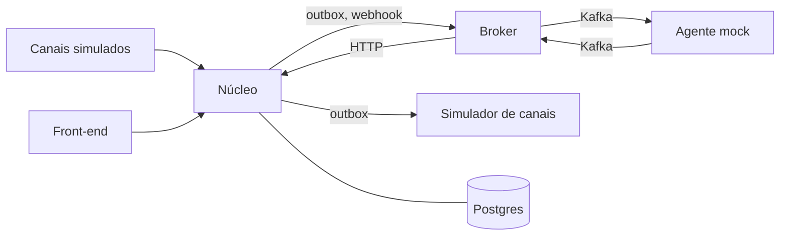

# Help Desk AI First

Help desk próprio, multi-marca (InfinitePay, JIM) e multi-equipe, em que o agente de IA atende como um atendente dentro de filas configuráveis e o humano entra por escala. Projeto individual do Inteli com a CloudWalk.

## Problema

A CloudWalk já tem um agente de IA que atende de ponta a ponta, ligado ao help desk por webhook, broker e Kafka. O help desk é de terceiros: lento, com defeitos recorrentes e sem a estrutura multi-marca e multi-equipe da operação. A entrega é um help desk que recebe o agente como atendente, distribui os atendimentos em filas que a operação edita sem deploy e passa para humanos com contexto, sem perder nem duplicar mensagens.

O volume não é o desafio: 10 mil atendimentos por dia (estresse de 50 mil, meta de teste de 100 msg/s) cabem com folga em Postgres e Kafka. O desafio é confiabilidade e estado: milhares de conversas abertas ao mesmo tempo, com falhas, reentregas e picos (`docs/arquitetura.md`, seção 3).

## Arquitetura



- **Núcleo** (`nucleo/`, FastAPI): entrada dos canais, triagem, roteador de filas (função pura), distribuidor com envelhecimento de prioridade, `transicionar` (toda escrita na conversa acontece sob a trava dela, nessa transação), outbox e relay, agendador de prazos, painel do analista, filas versionadas (re-roteamento de fila removida ao ativar), supervisor e reconciliador sob demanda.
- **Broker** (`broker/`): ponte da estrutura atual. Só responde ao webhook depois do ack do Kafka e só confirma o offset da volta depois do núcleo responder. O laço da volta tem supervisor: reinicia depois de exceção, e `/saude` responde 503 enquanto isso.
- **Agente mock** (`agente_mock/`): faz o papel do agente da CloudWalk, que está fora do escopo. Modos `normal`, `lento`, `duplicar`, `fora`.
- **Simulador de canais** (`canais/`): a ponta onde o cliente recebe; grava cada entrega para o juiz do experimento.

Garantias: entrega pelo menos uma vez com deduplicação na entrada, na API do agente e no mock (inbox), e saída por canal pelo menos uma vez, deduplicada no adaptador pelo id do evento; outbox transacional, fencing por `id_atribuicao` (resposta atrasada do agente não atropela o humano), prazo do agente contado do ack do broker, auditoria só de inserção com o porquê de cada decisão.

Documentos: [`docs/arquitetura.md`](docs/arquitetura.md) (o quê e por quê, com decisões e referências), [`docs/implementacao.md`](docs/implementacao.md) (como), [`docs/referencias.md`](docs/referencias.md), [`docs/api-front.md`](docs/api-front.md), [`docs/diario.md`](docs/diario.md), revisões em [`docs/revisoes/`](docs/revisoes/).

## Instalação

Requisitos: Docker com Compose, Python 3.12 (só para testes e experimento).

```bash
docker compose up -d --build
```

| Serviço | Endereço |
|---|---|
| API do núcleo e OpenAPI | http://localhost:8000/docs |
| Broker | http://localhost:8100 |
| Agente mock | http://localhost:8200 |
| Simulador de canais | http://localhost:8310 |
| Postgres | localhost:5433 (helpdesk / helpdesk) |
| Kafka (Redpanda) | localhost:19092 |

Testes:

```bash
py -3.12 -m venv .venv
.venv\Scripts\python -m pip install -r requirements.txt -r requirements-dev.txt
.venv\Scripts\python -m pytest testes/test_contrato.py testes/test_dominio.py
.venv\Scripts\python -m pytest testes/test_integracao.py
.venv\Scripts\python testes\fumaca.py
```

- `test_contrato.py` e `test_dominio.py`: 41 testes unitários (contrato, triagem, roteador, validação de regras, escolha do atendente, resposta do mock a cada mensagem pendente).
- `test_integracao.py`: 10 testes contra o Postgres do compose, num banco descartável que o próprio arquivo cria e apaga; roda sozinho, num comando à parte. Cobre concorrência em `transicionar`, transição inválida, fencing, capacidade sob concorrência, `SEM_CAPACIDADE` sem deixar a conversa sem dono, auditoria só de inserção, conversa aberta única, deduplicação na entrada e na API do agente, tipo de evento desconhecido, fila da equipe filtrada antes do limite.
- `fumaca.py`: 18 verificações em 7 cenários contra o ambiente no ar: caminho feliz, reenvio deduplicado, escala para humano com resumo, resposta do analista e devolução para a IA, só o dono responde, timeout com a resposta atrasada descartada pelo fencing, reconciliação (confere I3 a I6).

O que o desenho previa e não tem teste automatizado está em `docs/implementacao.md`, seção 13, com o meio que cobre cada caso, quando há.

## Front-end

A interface está em [`front/`](front/) (Next.js e TypeScript) e consome a API do núcleo pelo contrato de [`docs/api-front.md`](docs/api-front.md) e do OpenAPI em `/docs`. Sem autenticação: o perfil é escolhido na tela.

| Tela | O que cobre do TAP |
|---|---|
| `/cliente` | Conversa do lojista com o atendente: marca, canal (chat, WhatsApp, e-mail), reenvio deduplicado |
| `/analista` | Painel do analista: fila de escalas, resumo com as mensagens-fonte, histórico, perfil, auditoria; assumir, responder, devolver para a IA, encerrar |
| `/filas` | Filas editáveis pela operação: editor, validar, simular, criar versão, ativar, rollback |
| `/conversas` | Rastreabilidade: linha do tempo da auditoria com o porquê de cada decisão |
| `/supervisor` | Métricas, ocupação, fila de erros da outbox, reconciliação I1 a I6 |

```bash
cd front
npm install
npm run dev        # http://localhost:3000
```

Testado no navegador contra o ambiente no ar, em 24/11/2026: envio, reenvio duplicado, escala por pedido do cliente, resposta do analista, devolução com nota, encerramento, validar, criar versão, ativar, rollback, simular e reconciliação. Não testados pela tela: "Assumir" (pede uma escala esperando na fila, com todos os analistas da equipe cheios) e "Reprocessar" da outbox (pede item em erro).

A demonstração tem reserva sem o front: `carga/demo.py` percorre os 7 momentos do roteiro (`docs/arquitetura.md`, 19.4) contra o ambiente no ar, com pausa a cada momento:

```bash
.venv\Scripts\python -m carga.demo
```

## Modelos e configurações

**Agente (simulado).** Mock determinístico, sem LLM: `agente_mock/main.py`, versão = o commit do repositório. Não há modelo nem temperatura; a resposta é uma frase fixa por troca (6 por idioma) e a decisão de escalar é uma expressão regular sobre a última mensagem do cliente. Configuração: `LATENCIA_MS` (800, latência simulada por resposta), `MOCK_TROCAS` (6, trocas até resolver), `TIMEOUT_AGENTE_S` (30) e o modo (`normal`, `lento`, `duplicar`, `fora`, por `POST /modo`). Na atribuição, responde cada mensagem do cliente que esperou na fila, com `sequencia` 0, 1, 2 (ids próprios). Determinístico de propósito: o experimento mede a plataforma, não a qualidade das respostas.

**Canais (simulados).** `canais/main.py` grava cada entrega e deduplica pelo id do evento. `POST /modo` aceita `fora` (canal indisponível) e `recusar` (trecho de conteúdo recusado com 500, usado na hipótese H2).

**Núcleo.** Variáveis do núcleo (no `.env` ou no ambiente do compose): `OUTBOX_ATIVA`, `INBOX_ATIVA`, `FENCING_ATIVO`, `TIMEOUT_ATIVO` (chaves de ablação, `true` por padrão), `TIMEOUT_AGENTE_S` (30), `RETENTATIVAS_MAX` (8), `HISTORICO_N` (20), `CAPACIDADE_HUMANO` (3), `CAPACIDADE_IA` (1.000.000, na prática sem limite), `ENVELHECIMENTO_S` (600, hipótese). Lista completa em `docs/implementacao.md`, seção 10. As filas são configuradas pela API (`/filas`), sem deploy.

## Metodologia do experimento

Mede a robustez da plataforma, não a qualidade das respostas do agente.

- **Ablação:** uma versão só, com chaves que desligam cada proteção. Cada cenário roda com a chave que ele testa ligada e desligada.
- **Cenários:** E1 base (outbox e inbox juntas), E3b reenvio de 10% das mensagens pelo canal 2 s depois (inbox), E6 broker fora por 60 s (outbox).
- **Carga:** gerador Python (`carga/gerador.py`, no lugar do k6), 6 mensagens por conversa, 84 s entre elas, 7 min de aquecimento e 5 min medidos, agenda com semente fixa (`carga/agenda.py`; `--semente` de `carga/rodar.py`, padrão 42). A meta era 100 msg/s (8,3 conversas/s); num teste com o código anterior às correções de desempenho a máquina saturou perto de 70 msg/s no total (~35 de cliente), então as execuções rodam no plano B do documento: **50 msg/s nas duas direções (4,15 conversas/s)**, com o banco limpo e o código do commit atual. As previsões foram reescalonadas para 50 msg/s antes de ver a tabela (`docs/implementacao.md`, seção 14).
- **Juiz nas pontas:** conta o que o cliente enviou e o que o canal entregou. Liga cada resposta à mensagem pelo banco do núcleo: com a outbox ligada, de forma exata (o evento que o agente respondeu diz qual mensagem carregava); com a outbox desligada não há esse registro e vale a regra por ordem (a resposta pertence à última mensagem do cliente antes dela).
- **p95 interna:** da entrada da mensagem ao ack do broker, só para `mensagem.recebida` e só com a outbox ligada (desligada, não há linha de outbox: "—"). A 1ª mensagem de cada conversa fica fora da amostra.
- **Recuperação (E6):** da volta do broker até a última resposta entregue das mensagens enviadas durante a falha.
- O reconciliador (`GET /supervisor/reconciliacao`: I1, I1b, I2 a I6) é consulta sob demanda; não roda por execução do lote.

```bash
.venv\Scripts\python -m carga.lote
.venv\Scripts\python -m carga.tabelas
```

## Resultados

Uma execução por cenário e posição, 50 msg/s, 5 min medidos (7.469 mensagens do cliente em cada). Dados brutos em `resultados/<cenario>/<posicao>/` (CSV por mensagem e JSON com as métricas); tabela gerada por `python -m carga.tabelas`.

| Cenário | Proteção | Recusadas | Perdidas | Duplicadas | Escaladas | Espera p95 até a 1ª resposta | p95 interna | Recuperação |
|---|---|---|---|---|---|---|---|---|
| E1 base | desligada | 0 | 0 | 0 | 0 | 47,2 s | — | — |
| E1 base | ligada | 0 | 0 | 0 | 0 | 27,3 s | 0,10 s | — |
| E3b reenvio do canal | inbox desligada | 0 | 0 | **637** | 0 | 30,4 s | 0,12 s | — |
| E3b reenvio do canal | inbox ligada | 0 | 0 | **0** | 0 | 17,7 s | 0,10 s | — |
| E6 broker fora 60 s | outbox desligada | 0 | **1.455** | 0 | 25 | 37,7 s | — | 16,1 s |
| E6 broker fora 60 s | outbox ligada | 0 | **0** | 0 | 0 | 57,8 s | 18,0 s | 109,4 s |

**Leitura, contra a previsão escrita antes de rodar:**
- **H1 confirmada nos dois cenários de falha.** No E3b, sem a inbox, 637 dos 722 reenvios da janela (88%) viraram resposta duplicada para o cliente; com a inbox, zero. Os 85 que não duplicaram estão quase todos nas duas últimas mensagens da conversa (80 com k = 4 ou 5), onde o reenvio conta como uma troca a mais e antecipa o fim da conversa pelo mock (6 trocas); o mecanismo exato não foi investigado. No E6, sem a outbox, 1.455 mensagens (19%) ficaram sem resposta e sem escala: o `POST` direto falhou e, como o prazo do agente só nasce no envio, nada escalou. Com a outbox, **zero perda e zero duplicata**: o que estava na fila durante os 60 s foi entregue depois, com atraso (p95 interna de 18 s nessa execução, contra 0,1 s sem falha). 41 mensagens foram enviadas a conversas que já tinham escalado (coluna "esperando humano" do JSON): são as escalas por timeout das respostas presas no caminho de volta quando o broker caiu, previstas na seção 14 (20 a 30 escaladas); a escala delas não entra na coluna "Escaladas" porque a resposta do agente também chegou, e o juiz dá precedência à resposta.
- **Recuperação acima da previsão.** O E6 ligado levou 109 s para entregar a última resposta das mensagens enviadas durante a falha, contra até ~70 s previstos. A previsão contava só o teto do backoff do relay (60 s); a drenagem da fila acumulada no caminho de volta, na mesma máquina, levou mais do que os "segundos" estimados. O E6 desligado "recupera" em 16 s porque não há fila: o que falhou foi perdido.
- **E1 sem falha:** zero perda e zero duplicata nas duas posições, como previsto. A p95 interna da posição ligada ficou em 0,10 s, abaixo da meta de 500 ms.
- **Espera até a 1ª resposta alta (17 a 47 s) em todos os cenários.** Não estava na previsão. A p95 interna (núcleo até o broker) é de 0,1 s, então o tempo está no caminho de volta: broker, Kafka, mock e de novo o núcleo, todos na mesma máquina com o gerador. Hipótese: o mock e o consumidor da volta do broker são o gargalo a essa carga. A diferença entre as posições do E1 (47 s × 27 s, ao contrário do previsto) não é atribuível à proteção: as execuções rodaram em sequência sobre o mesmo banco, e a desligada foi a última, com o banco maior. Uma repetição só não separa esse efeito.
- **Juiz corrigido no meio do experimento.** A primeira execução do E6 ligado (arquivada em `resultados/_juiz_antigo/`) mostrou 7 perdidas e 7 duplicadas. Eram as mesmas 7 conversas: a resposta atrasada da mensagem enviada no primeiro 1,6 s da queda chegou depois da mensagem seguinte (84 s), e a regra por ordem a atribuiu à seguinte. O juiz passou a ligar a resposta de forma exata quando a outbox existe: E1 e E3b desligada foram rejulgados com ele (`carga/rejulgar.py`) e o E6 ligado foi refeito. O E3b ligado foi julgado pela regra antiga, com o banco já apagado; ela só erra com resposta atrasada além da mensagem seguinte, o que não ocorre sem falha (zero perdidas e zero duplicadas). Na posição desligada a regra por ordem continua e esse erro pode existir lá (no E6 desligado as respostas não atrasam, porque não há retentativa).

### Testes de carga e hipóteses (depois do experimento)

Detalhe em [`docs/testes-de-carga.md`](docs/testes-de-carga.md); validação ponto a ponto em [`docs/validacao-pontos.md`](docs/validacao-pontos.md).

| Teste | Resultado |
|---|---|
| 100 mil mensagens de 20 mil clientes, ~46 msg/s do cliente (~92 no total) | 100.000 respondidas, 0 duplicatas, 0 escalas, espera p95 8,7 s, p95 interna 0,45 s, reconciliação zerada, 37 min |
| H2: 19% de reenvios, relay fora 38 s, 1% de mensagens envenenadas | 0 duplicatas ao cliente, 0 violações de ordem; as envenenadas estacionaram só a sua conversa |
| H3: 1.000 pedidos de atendente | 1.000 com nota de handoff e tempo estimado informado ao cliente |
| H1: 200 msg/s no total | Não passa numa máquina (fila cresce; 0 perdas, 0 duplicatas) |
| Da clonagem à demo | 3,3 min com as imagens base no cache |

## Limitações

- Ambiente local, agente mock com texto fixo, dados sintéticos, premissas de volume (12 mensagens por atendimento, pico de 5x).
- Entrega pelo menos uma vez onde não controlamos o receptor; o id determinístico é requisito imposto ao agente. A saída por canal é deduplicada no adaptador pelo id do evento (desde 23/11): o adaptador real de cada canal precisa fazer o mesmo.
- Item em `erro` na outbox estaciona os seguintes da mesma conversa até o reprocessamento (a ordem vale, mas a conversa espera o supervisor); as outras conversas seguem (H2).
- Redpanda de um nó em modo de desenvolvimento, que confirma sem fsync.
- Fila no caminho de volta conta contra o agente: resposta presa no broker escala por timeout.
- O formato do contrato é proposta nossa (o da CloudWalk não é público); marca fixa no contrato.
- Canais simulados: janela de 24 h do WhatsApp e encadeamento de e-mail ficam de fora.
- A ablação desliga uma chave por vez e não mede interações entre proteções.
- Postgres sem réplica: falha de disco ou de banco não é testada.
- Sem autenticação (perfil escolhido na tela). O isolamento por marca no banco (RLS, papel `leitura_marca`) vale para as leituras feitas em nome de uma marca; os processos do núcleo atendem as duas marcas com o papel da aplicação.
- O gerador de carga (Python, no lugar do k6) roda na mesma máquina e disputa CPU com o sistema.
- A qualidade do resumo de handoff não é medida.
- Sem inatividade: conversa com humano esperando o cliente ocupa vaga até o analista encerrar.
- O juiz depende do banco do núcleo para ligar resposta a mensagem e supõe uma resposta antes da mensagem seguinte da conversa.
- Uma repetição por cenário e posição: sem variância; vale zero contra não zero e a ordem de grandeza.
- Experimento a 50 msg/s, não a 100. Os testes de carga posteriores ([docs/testes-de-carga.md](docs/testes-de-carga.md)), com o gerador dentro da rede do Docker, mediram a capacidade numa máquina só (14 núcleos lógicos, tudo junto):
  - ~92 msg/s totais sustentados (45,8 do cliente), com p95 interna de 0,45 s: 100 mil mensagens, todas respondidas, espera p95 de 8,7 s;
  - a ~156 msg/s totais (hipótese H1, meta de 200) o sistema não acompanha: nada se perde nem duplica, mas a fila cresce e o prazo do agente escala conversas para humano. 200 msg/s pede mais de uma máquina; a escala horizontal não foi testada;
  - sem controle de admissão: acima da capacidade, a espera cresce sem limite;
  - as telas do front passam de 1 s de p95 com 100 clientes e 50 msg/s de fundo (medido antes da rodada de desempenho).
- A IA não tem limite de capacidade (o limite por custo é Evolução) e não mantém contador de ocupação: atualizar a linha dela a cada atribuição serializava a marca inteira (medido em 24/11). A ocupação da IA é contada na leitura.
- p95 interna só na posição ligada e sem a 1ª mensagem de cada conversa (subestima a latência de quem abre a conversa); a comparação de custo entre as posições fica com a espera até a 1ª resposta.
- Reconciliador simplificado e sob demanda: I3 não compara conteúdo (não vê a duplicata do E3b) e I1 só olha conversas com a IA; quem mede perda e duplicata é o juiz.
- Re-roteamento de fila removida pula a conversa travada no instante da ativação (`SKIP LOCKED`); ela só é re-roteada na ativação seguinte. Envelhecimento (`ENVELHECIMENTO_S` = 600 s) é hipótese, sem medida; nenhum dos dois tem teste próprio.
- Parte dos testes previstos não está automatizada (Kafka fora, deadlock, reinício, invariantes plantadas, distribuidor): lista e cobertura alternativa em `docs/implementacao.md`, seção 13.
- Cenários fora da entrega: duplicatas do agente, agente lento e fora como cenário medido, núcleo morto, disjuntor, escalabilidade horizontal. Desenho e previsão em `docs/implementacao.md`, seção 14.

## Evolução

Disjuntor por saúde do agente com política por fila, renovação de prazo (heartbeat), inatividade e SLA, reabertura e fusão de identidades, capacidade da IA por custo (sem travar a linha da IA), reconciliador periódico com I3 por conteúdo, canal ao vivo (SSE), memória semântica com embeddings, várias instâncias medidas, migração gradual para Ruby. Detalhes em `docs/arquitetura.md`, seção 21, e `docs/diferenciais.md`.
