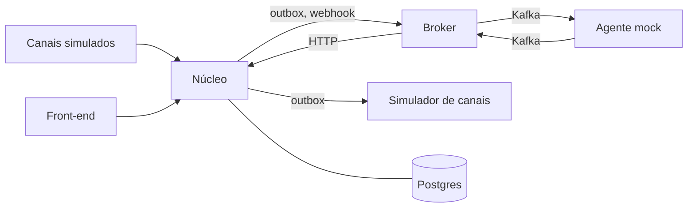

# Help Desk AI First

Help desk próprio, multi-marca (InfinitePay, JIM) e multi-equipe, em que o agente de IA atende como um atendente dentro de filas configuráveis e o humano entra por escala. Projeto individual do Inteli com a CloudWalk.

## Problema

A CloudWalk já tem um agente de IA que atende de ponta a ponta, ligado ao help desk por webhook, broker e Kafka. O help desk é de terceiros: lento, com defeitos recorrentes e sem a estrutura multi-marca e multi-equipe da operação. A entrega é um help desk que recebe o agente como atendente, distribui os atendimentos em filas que a operação edita sem deploy e passa para humanos com contexto, sem perder nem duplicar mensagens.

O volume não é o desafio: 10 mil atendimentos por dia (estresse de 50 mil, meta de teste de 100 msg/s) cabem com folga em Postgres e Kafka. O desafio é confiabilidade e estado: milhares de conversas abertas ao mesmo tempo, com falhas, reentregas e picos (`docs/arquitetura.md`, seção 3).

## Arquitetura



- **Núcleo** (`nucleo/`, FastAPI): entrada dos canais, triagem, roteador de filas (função pura), distribuidor, `transicionar` (único caminho que escreve na conversa), outbox e relay, agendador de prazos, painel do analista, filas versionadas, supervisor e reconciliador.
- **Broker** (`broker/`): ponte da estrutura atual. Só responde ao webhook depois do ack do Kafka e só confirma o offset da volta depois do núcleo responder.
- **Agente mock** (`agente_mock/`): faz o papel do agente da CloudWalk, que está fora do escopo. Modos `normal`, `lento`, `duplicar`, `fora`.
- **Simulador de canais** (`canais/`): a ponta onde o cliente recebe; grava cada entrega para o juiz do experimento.

Garantias: entrega pelo menos uma vez com deduplicação nas pontas (inbox), outbox transacional, fencing por `id_atribuicao` (resposta atrasada do agente não atropela o humano), prazo do agente contado do ack do broker, auditoria só de inserção com o porquê de cada decisão.

Documentos: [`docs/arquitetura.md`](docs/arquitetura.md) (o quê e por quê, com decisões e referências), [`docs/implementacao.md`](docs/implementacao.md) (como), [`docs/referencias.md`](docs/referencias.md), [`docs/api-front.md`](docs/api-front.md), [`docs/diario.md`](docs/diario.md), revisões em [`docs/revisoes/`](docs/revisoes/).

## Instalação

Requisitos: Docker com Compose, Python 3.12 (só para testes e experimento).

```bash
docker compose up -d --build
```

| Serviço | Endereço |
|---|---|
| API do núcleo e OpenAPI | http://localhost:8000/docs |
| Broker | http://localhost:8100 |
| Agente mock | http://localhost:8200 |
| Simulador de canais | http://localhost:8310 |
| Postgres | localhost:5433 (helpdesk / helpdesk) |
| Kafka (Redpanda) | localhost:19092 |

Testes:

```bash
py -3.12 -m venv .venv
.venv\Scripts\python -m pip install -r requirements.txt -r requirements-dev.txt
.venv\Scripts\python -m pytest testes/test_contrato.py testes/test_dominio.py
.venv\Scripts\python testes\fumaca.py
```

A fumaça roda 19 cenários contra o ambiente no ar: caminho feliz, reenvio deduplicado, escala para humano com resumo, devolução para a IA, só o dono responde, timeout com a resposta atrasada descartada pelo fencing, reconciliação zerada.

## Configuração

Variáveis do núcleo (no `.env` ou no ambiente do compose): `OUTBOX_ATIVA`, `INBOX_ATIVA`, `FENCING_ATIVO`, `TIMEOUT_ATIVO` (chaves de ablação, `true` por padrão), `TIMEOUT_AGENTE_S` (30), `RETENTATIVAS_MAX` (8), `HISTORICO_N` (20), `CAPACIDADE_HUMANO` (3). Lista completa em `docs/implementacao.md`, seção 10. As filas são configuradas pela API (`/filas`), sem deploy.

## Metodologia do experimento

Mede a robustez da plataforma, não a qualidade das respostas do agente.

- **Ablação:** uma versão só, com chaves que desligam cada proteção. Cada cenário roda com a chave que ele testa ligada e desligada.
- **Cenários:** E1 base (outbox e inbox juntas), E3b reenvio de 10% das mensagens pelo canal 2 s depois (inbox), E6 broker fora por 60 s (outbox).
- **Carga:** 8,3 conversas novas por segundo, 6 mensagens cada, 84 s entre elas; 100 msg/s nas duas direções em regime. 7 min de aquecimento e 5 min medidos. Agenda com semente fixa (`carga/agenda.py`).
- **Juiz nas pontas:** conta o que o cliente enviou e o que o canal entregou; liga cada resposta à mensagem pelo banco do núcleo.

```bash
.venv\Scripts\python -m carga.lote
.venv\Scripts\python -m carga.tabelas
```

## Resultados

RESULTADOS_AQUI

## Limitações

- Ambiente local, agente mock com texto fixo, dados sintéticos, premissas de volume (12 mensagens por atendimento, pico de 5x).
- Entrega pelo menos uma vez onde não controlamos o receptor; o id determinístico é requisito imposto ao agente.
- Redpanda de um nó em modo de desenvolvimento, que confirma sem fsync.
- Fila no caminho de volta conta contra o agente: resposta presa no broker escala por timeout.
- O formato do contrato é proposta nossa (o da CloudWalk não é público); marca fixa no contrato.
- Canais simulados: janela de 24 h do WhatsApp e encadeamento de e-mail ficam de fora.
- A ablação desliga uma chave por vez e não mede interações entre proteções.
- Postgres sem réplica: falha de disco ou de banco não é testada.
- Sem autenticação (perfil escolhido na tela); isolamento por marca só por filtro.
- O gerador de carga (Python, no lugar do k6) roda na mesma máquina e disputa CPU com o sistema.
- A qualidade do resumo de handoff não é medida.
- Sem inatividade: conversa com humano esperando o cliente ocupa vaga até o analista encerrar.
- O juiz depende do banco do núcleo para ligar resposta a mensagem e supõe uma resposta antes da mensagem seguinte da conversa.
- Uma repetição por cenário e posição: sem variância; vale zero contra não zero e a ordem de grandeza.
- Na configuração do experimento a IA não tem limite de capacidade (a capacidade como limite de custo está em evolução).
- Cenários fora da entrega: rampa até 200 msg/s, duplicatas do agente, agente lento e fora como cenário medido, núcleo morto, disjuntor, escalabilidade horizontal. Desenho e previsão em `docs/implementacao.md`, seção 14.

## Evolução

Disjuntor por saúde do agente com política por fila, renovação de prazo (heartbeat), inatividade e SLA, reabertura e fusão de identidades, envelhecimento de prioridade, capacidade da IA por custo, canal ao vivo (SSE), memória semântica com embeddings, várias instâncias medidas, migração gradual para Ruby. Detalhes em `docs/arquitetura.md`, seção 21, e `docs/diferenciais.md`.
