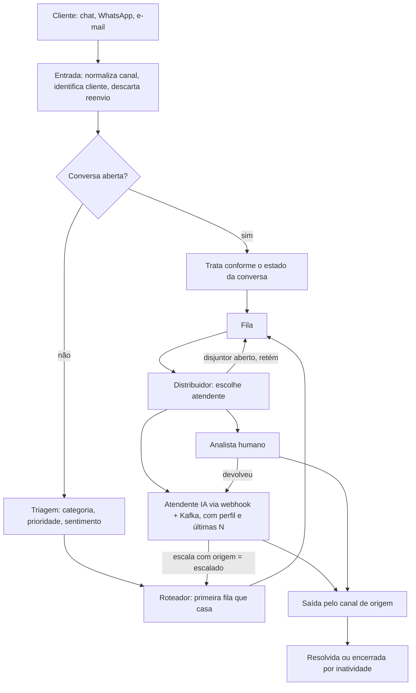
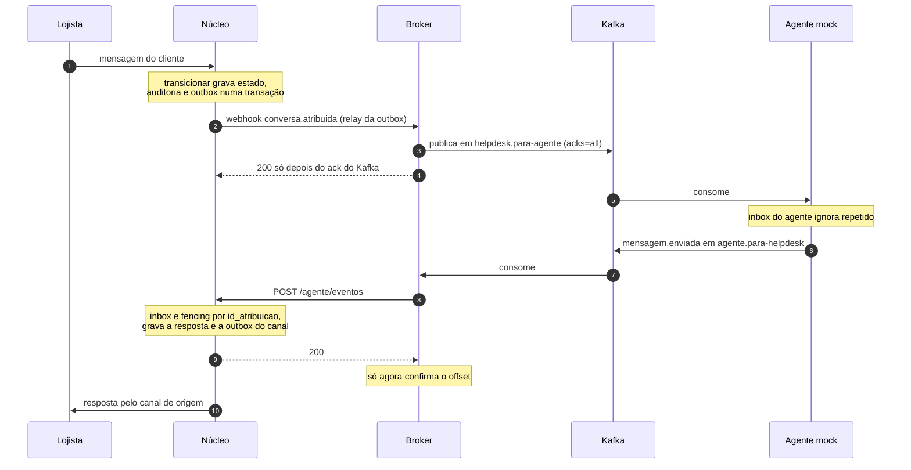
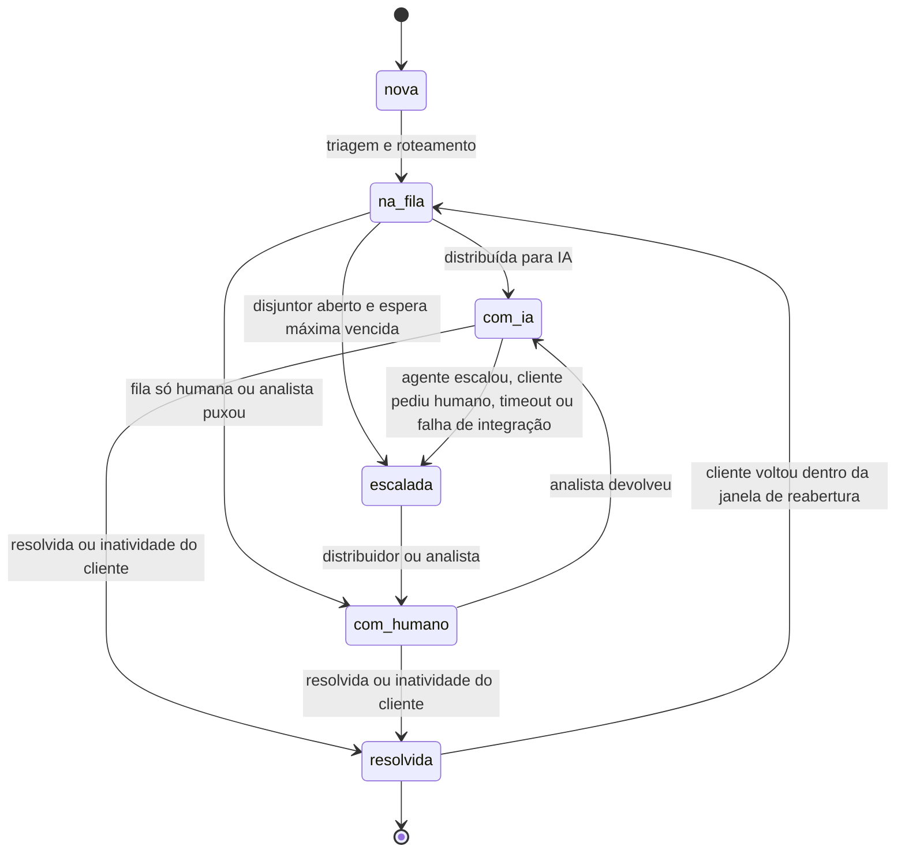
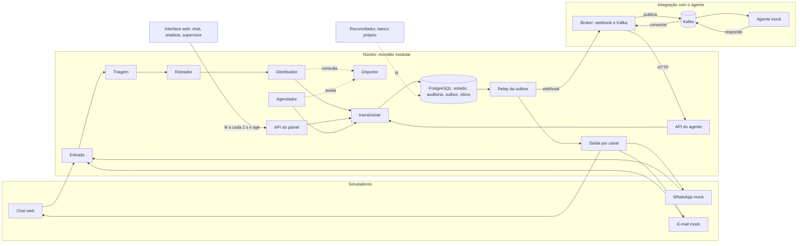
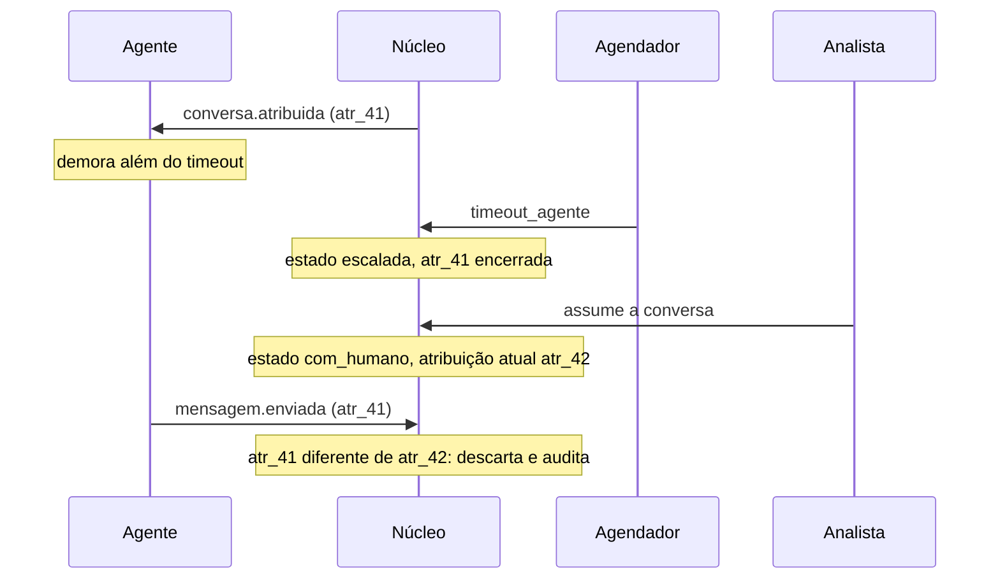

# Arquitetura: Help Desk AI First

Plataforma de help desk própria para a CloudWalk: multi-marca, multi-equipe, com o agente de IA atuando como atendente e o analista humano entrando por escalação.

Documento vivo. O status de cada decisão (Decidida, Proposta, Em aberto, Evolução) fica só na tabela da seção 20. As decisões D-1 a D-7 da revisão (`revisoes/rodada-1-auditoria.md`, seção 7.1) foram aprovadas pelo usuário em 2026-11-20 e estão aplicadas.

Referências em [`referencias.md`](referencias.md); diferenciais em [`diferenciais.md`](diferenciais.md); como construir em [`implementacao.md`](implementacao.md).

---

## 1. Problema

A CloudWalk (InfinitePay no Brasil, JIM nos EUA) atende milhões de lojistas por chat no app, WhatsApp e e-mail. Já tem um agente de IA que atende de ponta a ponta, integrado ao help desk por webhooks e Kafka. O help desk atual é de terceiros: lento, com defeitos recorrentes e sem espaço para a estrutura multi-marca e multi-equipe da operação.

**Entrega:** um help desk próprio que recebe o agente como atendente, distribui os atendimentos em filas configuráveis pela operação e faz handoff para humanos com contexto, aguentando o volume real com rastreabilidade de cada decisão.

**Fora de escopo (TAPI):** desenvolver o agente de IA, dados reais, integração com sistemas de produção, apps móveis.

## 2. Requisitos

Numeração do enunciado:
1. Receber mensagens de chat, WhatsApp e e-mail (simulados).
2. Filas múltiplas, configuráveis e editáveis pela operação, sem deploy.
3. Triagem, priorização e distribuição entre IA e humanos.
4. Integração com o agente (mock) por webhook + broker + Kafka, no formato da estrutura atual.
5. Interface de conversa e painel do analista com fila de escalas, contexto e histórico.
6. Handoff com resumo, preservando o histórico.
7. Auditoria de cada decisão de atendimento e de escala.
8. Memória e contexto entre interações (seção 13).
9. Volume de referência, inclusive com falhas, reentregas e picos.

Também: self-hosted (Docker); LGPD, só dados sintéticos; individual, com plataforma, experimento técnico e README. Entrega em 23/11/2026 (decisão do usuário em 2026-11-21): o que entra e o que vira Evolução está na seção 19.

O formato da "estrutura atual" do requisito 4 não é público; o contrato da seção 10 é proposta nossa.

## 3. Premissas de volume

| | Base | Estresse |
|---|---|---|
| Atendimentos por dia | 10.000 | 50.000 |
| Mensagens por dia (12 por atendimento) | 120.000 | 600.000 |
| Média | ~1,4 msg/s | ~7 msg/s |
| Pico (5x) | ~7 msg/s | ~35 msg/s |
| Pico com concentração em horário comercial | ~14 msg/s | ~70 msg/s |
| **Meta do teste de carga** | | **100 msg/s** |

**De onde vêm os números**
- 10 mil/dia: em 2023 a IA fez 75% dos atendimentos da InfinitePay, cerca de 2,6 milhões. Total ≈ 3,5 milhões/ano ≈ 9,5 mil/dia. *Dado público.*
- 50 mil/dia: a base de clientes foi de ~1,2 milhão (2023) para 6,3 milhões. Extrapolação linear. *Premissa.*
- 12 mensagens por atendimento (6 do cliente) e pico de 5x. *Premissas.*
- **"100 msg/s" = total das duas direções** (~50 do cliente e ~50 do atendente; ~8,3 conversas novas/s). O pico do E2 seria uma rampa até 200 msg/s (fora da entrega, 19.1). O k6 reproduz essa chegada e o L da tabela abaixo com 6 mensagens a cada 84 s por conversa (impl 14).

**Conversas abertas (Lei de Little, L = chegada × tempo em sistema).** O release da CloudWalk diz que o Claudio Walker respondia "em até sete minutos", contra 22 do analista: 420 s é tempo até resolver, não tempo em sistema. Conversa escalada e conversa esperando o cliente ficam abertas mais tempo. A fonte não traz taxa de escala; os 25% abaixo são hipótese.

| Cenário | Chegada (conversas/s) | Tempo em sistema | L |
|---|---|---|---|
| Pico de estresse | 2,9 | 420 s | ~1.200 |
| Meta do teste | 8,3 | 420 s | ~3.500 |
| Pico de estresse, 25% passando por humano (hipótese) | 2,9 | ~750 s | ~2.200 |
| Meta do teste, mesma hipótese | 8,3 | ~750 s | ~6.250 |

Por isso a capacidade da IA conta trabalho em voo (mensagens aguardando resposta), não conversas abertas; os humanos seguem contando conversas (seção 12). Na entrega a IA fica sem limite (19.1).

**Conclusão:** o volume é baixo para Postgres e Kafka. **O desafio não é throughput, é confiabilidade** (não perder nem duplicar, aguentar falha e reentrega) **e estado** (milhares de conversas com fila, contexto e histórico corretos). A escala horizontal (E9) ficou fora da entrega; H3 está declarada como não medida (seção 17).

## 4. Perfis de usuário

| Perfil | Origem | O que faz |
|---|---|---|
| Lojista | TAPI | Abre a solicitação por chat, WhatsApp ou e-mail |
| Agente de IA | TAPI | Atende como um usuário da plataforma; responde, executa ou escala |
| Analista humano | TAPI | Recebe escalas, assume ou apoia casos complexos |
| Supervisor de operação | **Adição nossa** | Configura filas, acompanha a saúde da operação |

O supervisor foi deduzido do requisito "configurável pela operação": alguém precisa ser dono da configuração.

## 5. Princípios da arquitetura

1. **Conversa com estado, não esteira.** Cada mensagem é tratada conforme o estado atual da conversa.
2. **A IA é um atendente, não uma etapa.** Ela fica dentro das filas, como um humano. Algumas filas vão direto para humanos.
3. **Escalar é voltar para o sistema de filas**, com `origem = escalado` e prioridade maior. O humano pode devolver para a IA.
4. **Confiabilidade antes de escala:** idempotência, retentativa, ordem por conversa e fila de erros.
5. **Tudo vira evento registrado.** A auditoria é transversal.
6. **Regras são dados, não código.** Filas e personas ficam no banco e são editadas pela interface. Marcas, não: são valor fixo no contrato, e uma terceira marca exige deploy.
7. **Monólito modular.** Só sai do núcleo o que precisa escalar ou falhar de forma independente.

## 6. Engenharia reversa

| De onde | O que pegamos |
|---|---|
| Chatwoot | Bot como atendente; handoff por status (bot → humano → bot) |
| Zendesk | Fila = condições + ordem + prioridade; primeira fila que casa leva; fila padrão como fallback |
| CloudWalk (TAPI) | Kafka entre plataforma e agente, alimentado por webhooks |
| **Onde melhoramos** | O Chatwoot retenta o webhook do agent bot só em 429 e 500; nas outras falhas (timeout, 502, 503) abre a conversa para humano, salvo a opção `keep_pending_on_bot_failure` (código-fonte, `lib/webhooks/trigger.rb`). Aqui: outbox com retentativa para qualquer falha, idempotência, fila de erros e disjuntor (o disjuntor é Evolução na entrega, 19.1) |

## 7. Fluxo de uma mensagem



Toda seta gera um evento de auditoria. Roteamento e distribuição gravam também as entradas da decisão (12.1). Na entrega, a retenção pelo disjuntor, a reabertura e a inatividade são Evolução, e a devolução só entra se sobrar tempo (19.1).

### 7.1 Sequência de uma mensagem (caminho feliz)



## 8. Estados da conversa



- **`escalada`** = na fila humana. A escala passa pelo roteador com `origem = escalado`, que escolhe a fila de escalas da marca e da equipe (princípio 3).
- **Reabertura:** dentro da janela (ex.: 24 h) a conversa volta a `na_fila`, passa de novo pelo roteador e perde o motivo e a hora do encerramento. Depois da janela, abre outra conversa, e o agente recebe o perfil operacional do cliente (seção 13).
- **Timeout:** sem resposta nem renovação do agente (11.7), vai para `escalada` com `timeout_agente`. Vale também depois de uma devolução.
- **Inatividade:** quando a plataforma espera o cliente e ele some, aviso e depois encerramento com motivo `inatividade` (11.8).
- **Na entrega (19.1):** sem `na_fila → escalada` (disjuntor), sem reabertura e sem inatividade; a devolução só se sobrar tempo.

## 9. Componentes



`transicionar` é o único caminho que escreve na conversa (11.2).

| Componente | Responsabilidade |
|---|---|
| **Simuladores de canal** | Geram mensagens com `id_externo`; reenviam com o mesmo id em erro; gravam as respostas entregues e a mensagem de transferência de cada escala (juiz do experimento, seção 17) |
| **Entrada** | Normaliza o canal, descarta reenvio pelo `id_externo`, identifica o cliente, abre ou encontra a conversa |
| **Triagem** | Categoria, prioridade e sentimento, por regras |
| **Roteador** | **Função pura**: atendimento + regras → fila. Também roteia as escalas |
| **Distribuidor** | Laço que tira conversas de `na_fila` e `escalada` e escolhe o atendente por preferência da fila e ocupação (seção 12) |
| **Disjuntor** | Saúde do agente; aberto, o distribuidor não escolhe a IA (11.9). Evolução na entrega |
| **Auditoria** | Log só de inserção, inclusive decisões de roteamento e distribuição |
| **Outbox e relay** | Nenhum evento para fora se perde; envio fora da transação, um item por vez (11.3) |
| **Broker** | Recebe webhooks, publica no Kafka, consome as respostas e chama a API do agente. Único que fala com o Kafka; sem banco |
| **Agente mock** | Consome do Kafka e responde, com latência simulada e modos de falha |
| **API do agente** | Recebe os eventos do agente. Idempotente; nunca devolve 500 por regra de negócio |
| **Agendador** | Prazos: timeout do agente, SLA, inatividade e espera retida. Na entrega, só o timeout do agente |
| **Reconciliador** | Lê o banco do núcleo, confere invariantes e grava as violações no próprio banco (11.6). Na entrega, script SQL com I1 a I4 no fim de cada execução |
| **Interface web** | Chat, acompanhamento, painel do analista, configuração de filas. Relê o estado pela API a cada 2 s |

**Fora do núcleo:** broker e agente mock, porque espelham a fronteira real com a CloudWalk e o experimento os derruba; reconciliador, para medir com o mesmo código qualquer combinação de chaves (seção 17).

**Interface sem canal ao vivo nesta entrega:** leitura periódica de 2 s basta para o painel e para a demonstração, e evita a conexão de `LISTEN`, a fila por navegador e o risco da trava global do NOTIFY. SSE fica como evolução.

## 10. Contrato com o agente

JSON com JSON Schema por tipo de evento e versionamento.

**Plataforma → agente**

| Evento | Quando |
|---|---|
| `conversa.atribuida` | Conversa caiu para a IA. Leva cliente, marca, fila, perfil operacional e últimas N mensagens (seção 13); a persona da marca entra se o D1 for feito. Nunca o histórico inteiro |
| `mensagem.recebida` | Nova mensagem do cliente |
| `conversa.devolvida` | Humano devolveu para a IA. Mesmo contexto de `conversa.atribuida`, mais a nota do analista |
| `conversa.encerrada` | Conversa fechou (resolvida ou inatividade) |

**Agente → plataforma**

| Evento | Quando |
|---|---|
| `mensagem.enviada` | Resposta ao cliente. Pode haver mais de uma por mensagem recebida, numeradas |
| `acao.executada` | Ação executada (mock). Vai para a auditoria, mesmo fora da atribuição |
| `conversa.escalada` | Pedido de handoff com motivo, resumo, prioridade sugerida e, opcional, as mensagens que sustentam o resumo |
| `conversa.resolvida` | Caso encerrado pelo agente |
| `agente.processando` | O agente ainda trabalha na mensagem; renova o prazo (11.7) |

**Envelope comum** (ids legíveis só para ilustrar; o código exige UUID)

```json
{
  "versao": "1.0",
  "id_evento": "evt_8f2a...",
  "tipo": "conversa.escalada",
  "id_conversa": "conv_123",
  "id_atribuicao": "atr_41",
  "causado_por": "evt_77c1...",
  "marca": "infinitepay",
  "timestamp": "2026-11-17T13:30:00-03:00",
  "dados": {
    "motivo": "cliente_irritado",
    "resumo": "Repasse de ontem não caiu; cliente já tentou 2 vezes.",
    "prioridade_sugerida": "alta"
  }
}
```

- `id_evento`: idempotência.
- `id_conversa`: chave de partição no Kafka. Ordem dentro da conversa.
- `id_atribuicao`: a atribuição a que o evento se refere; vencida, o evento é descartado (11.2). Na fatia 1, sem tabela de atribuições, o núcleo gera um id por conversa e o mock o devolve.
- `causado_por`: `id_evento` de origem; permite id determinístico em eventos derivados (11.1). Nulo quando o evento nasce do cliente. O mock o preenche desde a fatia 1.

**Formato do contrato.** O formato real do contrato da CloudWalk não é público. Este contrato é proposta nossa, com base no agent bot do Chatwoot e no que o TAPI descreve (webhook, broker, Kafka); ligar o agente real exige um tradutor no broker, o único componente que fala com ele.

**Requisito do contrato ao agente:** id determinístico nos eventos derivados (`id_derivado`). Sem ele, a deduplicação no núcleo não pega a reentrega. O mock cumpre; o agente real precisaria cumprir.

**Evolução do contrato.** Falha que evita: um campo novo quebra o consumidor que ainda não o conhece, e eventos guardados (Kafka, outbox, auditoria) convivem em versões diferentes. Decisão: eventos versionados com esquema fraco. `versao` casa com `^1\.\d+$`; dentro da versão principal só se acrescenta, sempre opcional; o leitor ignora campo que não conhece; tipo desconhecido é auditado e confirmado pelo consumidor, sem ir para a fila de erros; versão principal nova só para quebra; sem upcasting. `agente.processando` e `fontes` entram já na 1.0, porque o contrato ainda não tem consumidor. Base: Overeem et al. (2021), sobre sistemas *event sourced*, que listam cinco táticas; a recomendação de começar por essas duas vem de fonte secundária (rótulo em `referencias.md`); aqui a analogia vale para eventos em trânsito e na auditoria, já que o estado fica em tabelas. Na entrega, o envelope aceita `^1\.\d+$`; `agente.processando` é auditado e confirmado, sem renovar prazo (11.7 é Evolução).

**Tópicos Kafka:** `helpdesk.para-agente`, `agente.para-helpdesk`, `helpdesk.erros` (fila de erros do broker).

## 11. Confiabilidade e consistência

É o centro da avaliação ("robustez diante de falhas, reentregas e picos"). Cada decisão responde a uma falha que o experimento provoca (seção 17), e as quatro principais têm chave de ablação (outbox, inbox, fencing, timeout).

Garantia buscada: **entrega pelo menos uma vez, com deduplicação nas pontas que controlamos** (entrada, núcleo, mock, saída). Onde não controlamos o receptor (canais reais, agente real), é pelo menos uma vez. Mesmo princípio do exactly-once do Kafka: escrita idempotente e transacional (Wang et al., 2021).

Números de artigos nesta seção foram conferidos pelo resumo (rótulo em `referencias.md`), não no texto completo.

### 11.1 Causalidade e idempotência

**Falha que evita:** `mensagem.recebida` chega duas vezes e o cliente recebe a resposta em dobro; o WhatsApp reenvia o webhook e a mensagem vira duas.

**Decisão**
- Evento derivado tem id determinístico: `uuid5(causado_por, tipo, sequencia)`.
- Entrada dos canais: deduplica pela inbox, com `(canal, id_externo)` como chave e a entrada como consumidor; reenvio com o mesmo id não cria mensagem. `id_externo` é sempre gravado em coluna indexada sem unicidade, para o juiz ligar a resposta à mensagem enviada mesmo com a inbox desligada.
- Inbox `eventos_processados(consumidor, id_evento)` no núcleo, no mock e na saída por canal, na mesma transação do efeito. O broker não tem banco nem inbox: só repassa, e a deduplicação fica nas pontas.
- Offset confirmado só depois do efeito; a saída por canal também passa pela outbox.

**Base:** Saltzer, Reed e Clark (1984); Helland (2012); Richardson (outbox).

### 11.2 Caminho único de escrita da conversa

**Falha que evita:** resposta atrasada da IA cai no atendimento humano; transições simultâneas; capacidade estourada; duas conversas abertas para o mesmo cliente.

**Decisão:** toda mudança passa por `transicionar(conversa, para, ator, id_atribuicao)`, numa transação:
1. `SELECT ... FOR UPDATE` na conversa;
2. valida em `transicoes_permitidas`;
3. fencing: atribuição diferente da atual é descartada e auditada;
4. ao atribuir, confere a capacidade do novo atendente (humano sob a trava da linha dele) antes de encerrar a atribuição atual; sem capacidade, nada muda e a conversa fica com o dono atual;
5. grava estado, mensagem (com a atribuição declarada no evento e a vigente, e um número de sequência), auditoria e outbox. O contexto que vai ao agente (últimas N) é lido aqui, sob a trava.

- **Ordem de travas, sempre:** conversa → atendente novo (se humano) → agendamentos → atendente antigo (se humano) → disjuntor (Evolução na entrega). Nunca dois humanos na mesma transação: não há `com_humano → com_humano`.
- **Rejeição não é exceção:** transição inválida, descarte e falta de capacidade voltam como resultado, e a auditoria é confirmada. `acao.executada` descartada é auditada com o conteúdo. Resumo de escala atrasado é anexado à escala vigente.
- `eventos` recusa `UPDATE` e `DELETE` por trigger; `estado` tem `CHECK` com os seis valores.
- Índice único parcial de conversa aberta por cliente e marca.
- Nenhuma chamada HTTP dentro da transação.



**Base:** Bailis et al. (2015), 67 aplicações Rails com duplicatas por validação só na aplicação; Warszawski e Bailis (2017), 22 ataques por concorrência em 12 aplicações; Gray e Cheriton (1989); Kleppmann (2016), fencing token.

### 11.3 Ordem e falha na outbox

**Falha que evita:** evento posterior sai antes; evento que sempre falha trava o relay inteiro; falha no canal segura a mensagem seguinte para o agente.

**Decisão**
- Ordem por conversa **e destino**.
- Um item por transação: reserva curta, envio fora da transação, resultado numa transação nova.
- Retentativas limitadas, com backoff exponencial, teto e jitter.
- Esgotou: `erro` em transação própria. É a fila de erros do núcleo, com endpoint de reprocessamento; o núcleo não publica no Kafka.
  - Destino `broker`: escala com fencing pela `id_atribuicao` do evento. Antes do envio não há prazo do agente (11.5), então este é o único caminho de escala de um evento que não saiu; já escalada por outro motivo = nada a fazer, auditado.
  - Destino `canal`: não escala; alerta e reprocessamento.

**Base:** Yuan et al. (2014), 92% das falhas catastróficas estudadas vieram de tratamento errado de erro não fatal; AWS Builders' Library.

### 11.4 Fronteira com o broker

**Falha que evita:** o broker perde mensagem entre webhook e Kafka, ou entre Kafka e núcleo; um evento ruim trava a partição.

**Decisão**
- Ida: 2xx ao webhook só depois do ack do Kafka (`acks=all`, produtor idempotente).
- Volta: offset confirmado só depois do 2xx do núcleo. O núcleo devolve 200 para regra de negócio (transição inválida, descarte) e 503 quando depende de algo fora (banco).
  - 503 ou conexão recusada: contrapressão sem limite. O broker pausa a partição, espera e retoma, sem deixar de consultar o Kafka (senão o grupo rebalanceia).
  - 4xx ou esquema inválido: `helpdesk.erros`.
  - 500 repetido: retentativas limitadas, depois `helpdesk.erros` com alerta; o reprocessamento escala pela `id_atribuicao`.
- **Na entrega (19.1):** 2xx, 4xx e 503 (ou falha de rede, pausa sem limite) como acima. O 500 repetido vai a `helpdesk.erros` depois de `RETENTATIVAS_MAX` e o offset é confirmado, sem o reprocessamento que escala pela `id_atribuicao` (Evolução, 21); a conversa escala pelo `timeout_agente` pendente, então nada some sem aviso. Entre as tentativas a partição fica pausada (até ~2 min com os valores iniciais) e os timeouts das conversas dela contam contra o agente; aceito porque 500 é defeito do núcleo.

**Base:** Wang et al. (2021); Saltzer, Reed e Clark (1984); documentação do aiokafka (`pause`/`resume` sem rebalance; `max_poll_interval_ms`).

### 11.5 Agendador único

**Falha que evita:** prazos espalhados; cronômetro que conta contra o agente o atraso da própria plataforma.

**Decisão**
- Tabela `agendamentos` e um worker que chama `transicionar`. Tipos: timeout do agente (renovável, 11.7), SLA, inatividade (11.8), espera retida (11.9).
- Um item por transação: lê os vencidos sem travar; para cada um, trava a conversa (`SKIP LOCKED`), relê o agendamento sob a trava e age.
- O `timeout_agente` só nasce no ack do broker: o relay o cria na transação que marca `enviado`. Evento parado na outbox não cobra o agente; quem escala é o esgotamento do relay (11.3). Na subida do núcleo, prazos vencidos ganham um timeout inteiro. A fila no caminho de volta ainda conta contra o agente (limitação). Pela mesma regra, a capacidade da IA, quando entrar, não conta evento parado na outbox (seção 21). Na entrega, o agendador só tem o `timeout_agente`.

**Base:** Dai et al. (2018), valor errado e checagem ausente dominam os bugs de timeout; que um ponto só para prazos reduza esses erros é inferência nossa.

### 11.6 Reconciliador

**Falha que evita:** perda ou duplicata que ninguém vê.

**Decisão:** job periódico, por janela de tempo, que lê o banco do núcleo e grava as violações no próprio banco. O juiz do experimento são os registros das pontas (seção 17); o reconciliador explica onde a falha aconteceu.
- I1: toda mensagem de cliente foi coberta por um evento ao atendente, ou está no prazo; esperando humano conta à parte;
- I2: nenhum evento parado na outbox;
- I3: nenhuma resposta duplicada (mesmo `causado_por` e sequência, ou mesmo conteúdo com ids diferentes);
- I4: nenhuma resposta com atribuição declarada diferente da vigente;
- I5: nenhum atendente acima da capacidade;
- I6: nenhuma conversa aberta duplicada;
- I7: toda conversa que espera o cliente tem prazo de inatividade.

Que uma decisão de roteamento refeita dê a mesma fila é teste unitário, não invariante.

**Na entrega (19.1):** um script SQL com I1 a I4, rodado no fim de cada execução do experimento; o serviço periódico com banco próprio e I5 a I7 são Evolução.

**Base:** Saltzer, Reed e Clark (1984); Basiri et al. (2016).

### 11.7 Prazo renovável do agente

**Na entrega:** Evolução (19.1). O efeito está lá.

**Falha que evita:** o timeout fixo escala uma conversa que o agente estava resolvendo, e a resposta chega numa atribuição vencida.

**Decisão:** `agente.processando`, com o `causado_por` da mensagem e a atribuição atual, empurra o `timeout_agente` pendente: lease renovável, com teto de renovações (impl 10). Heartbeat de atribuição vencida não renova e é auditado.

**Base:** Gray e Cheriton (1989): o detentor estende o lease para manter o direito.

### 11.8 Encerramento por inatividade

**Na entrega:** Evolução (19.1). O efeito está lá.

**Falha que evita:** cliente some e a conversa fica aberta para sempre, ocupando capacidade, segurando o índice de conversa aberta e distorcendo métricas.

**Decisão:** só corre quando a plataforma espera o cliente (`com_ia` ou `com_humano`, última mensagem do atendente). Mensagem do atendente agenda o aviso; do cliente, cancela. Aviso pelo canal; depois `resolvida` com motivo `inatividade`, liberando a atribuição. Sob a trava, confere que o cliente não escreveu depois do agendamento. Prazos por canal (impl 10).

### 11.9 Disjuntor por saúde do agente

**Na entrega:** Evolução (19.1), com as correções da rodada 3 anotadas na seção 21.

**Falha que evita:** o agente cai, as conversas estouram o timeout e vão para humanos; o agente volta, mas a sobrecarga humana continua (falha metaestável).

**Decisão** (versão simplificada)
- Estado por atendente IA (`fechado`, `aberto`, `meio_aberto`), mudado sob a trava da linha do disjuntor.
- Sinal: desfecho dos últimos N `timeout_agente` (janela por contagem), reavaliado a cada desfecho. Com os valores iniciais, abre depois de cerca de 10 escalas (metade da amostra mínima). Esgotamento do relay para a IA (falha de integração) conta como falha na janela, porque evento que não saiu não gera timeout (11.5).
- Aberto: o distribuidor não escolhe a IA, e cada fila segue o seu `ao_abrir_disjuntor` (seção 12). `reter`, o padrão: a conversa nova fica em `na_fila`, o cliente recebe uma mensagem de espera e ninguém espera além de `ESPERA_MAX_RETIDA_S` (depois, escala com `agente_indisponivel`). `transbordar`: a conversa vai ao próximo grupo da fila (equipe). Conversas que já estavam com a IA seguem a regra normal de timeout.
- Meio-aberto: poucas conversas novas vão para a IA como sonda; só as sondas decidem. Sonda cancelada devolve a vaga.
- Mudança de estado vira auditoria e alerta ao supervisor.
- A chamada é assíncrona, então a falha é o timeout. Com `reter`, o que se protege é a carga humana; com `transbordar`, a espera do cliente, e a carga humana não cai (a conversa iria à mesma equipe pelo timeout).

**Base:** Nygard (2018), livro; Fowler (2014); Bronson et al. (2021) e Huang et al. (2022), 22 falhas metaestáveis em 11 organizações; Zhou et al. (2018), descarte por prioridade de negócio no WeChat.

### 11.10 Resumo

| Risco | Decisão |
|---|---|
| Plataforma salva e cai antes de avisar o agente | Outbox (11.3) |
| Evento duplicado, reenvio do canal | Id determinístico, inbox nas pontas, `id_externo` (11.1) |
| Resposta atrasada depois de troca de dono | Fencing (11.2) |
| Transições concorrentes, deadlock | `transicionar` com ordem de travas fixa (11.2) |
| Fora de ordem; evento que sempre falha | Ordem por conversa e destino; um item por transação; fila de erros (11.3) |
| Broker ou núcleo cai | Ack depois do Kafka; offset depois do núcleo; pausa da partição (11.4) |
| Agente lento ou fora | Timeout desde o ack (11.5); renovação (11.7); disjuntor (11.9) |
| Cliente some | Inatividade (11.8) |
| Perda que ninguém vê | Registros nas pontas e reconciliador (11.6, 17) |

## 12. Filas e distribuição

**Fila:** regra de entrada + ordem interna + quem atende.

```json
{
  "id": "fila_jim_credito",
  "nome": "JIM - Crédito Urgente",
  "ordem": 1,
  "prioridade": 3,
  "ao_abrir_disjuntor": "reter",
  "condicoes": {
    "todas": [
      { "campo": "marca", "operador": "igual", "valor": "jim" },
      { "campo": "categoria", "operador": "igual", "valor": "credito" }
    ]
  },
  "atendentes": [
    { "tipo": "ia", "id": "agente_ia" },
    { "tipo": "equipe", "id": "time_credito_us" }
  ]
}
```

- **Condições:** campos `marca`, `canal`, `categoria`, `prioridade`, `idioma`, `segmento_cliente`, `sentimento`, `origem`; operadores `igual`, `diferente`, `em`; combinação `todas` ou `qualquer`.
- **Roteamento:** filas testadas em ordem; a primeira que casa leva; sem match, fila padrão (Zendesk). O id da fila é texto estável entre versões.
- **Prioridade:** inteiro (1 baixa, 2 média, 3 alta), na fila e na conversa; maior primeiro.
- **Ordem:** prioridade da fila, `origem = escalado` antes, prioridade da conversa com envelhecimento (sobe um degrau a cada `ENVELHECIMENTO_S` de espera) e espera. Na entrega, sem envelhecimento (decisão 10, Evolução; quando entrar, conta de `na_fila_desde`, seção 21): uma fila de prioridade menor que divide equipe com outra pode esperar sem limite sob carga contínua.
- **`atendentes`:** lista ordenada de grupos (IA ou equipe); a ordem é a preferência. Nas filas AI first a IA vem primeiro, e a equipe recebe quando a IA está sem capacidade. Dentro do grupo, menor ocupação. Capacidade: humano por conversa aberta (ex.: 3); IA por mensagens aguardando resposta (seção 3). Na entrega a IA fica sem limite (decisão 39 é Evolução). Sem inatividade na entrega, conversa com humano esperando o cliente ocupa vaga até o analista encerrar; poucas conversas esquecidas lotam um analista de 3 vagas (limitação, seção 17).
- **`ao_abrir_disjuntor`:** `reter` (padrão) ou `transbordar`, declarado por fila (11.9). Evolução na entrega.
- **Distribuidor:** laço a cada 1 s e depois de cada transição que libera capacidade. Considera só as filas com algum grupo elegível com capacidade (disjuntor e política incluídos), escolhe a primeira conversa delas pela ordem acima com `SKIP LOCKED` e chama `transicionar`: uma conversa por transação, para instâncias não se travarem nem desfazerem decisões em lote. `SEM_CAPACIDADE` tira a fila do ciclo. O analista também pode puxar da fila de escalas.
- **Escala:** volta ao roteador com `origem = escalado`, que escolhe a fila de escalas da marca e da equipe. O analista vê só as filas dele.
- **Handoff:** `conversa.escalada` traz motivo e resumo; o analista vê o histórico completo. O resumo aparece com links para as mensagens de origem (`fontes`); sem fontes, marcado como tal, porque resumo abstrativo alucina (Maynez et al., 2020). Escala por timeout ou falha usa resumo de reserva extrativo (triagem + últimas N mensagens). Ao escalar, o cliente recebe pelo canal uma mensagem de sistema de transferência, que é também como o juiz vê a escala (seção 17).
- **Gatilhos de escala:** pedido do agente, pedido do cliente, sentimento negativo, timeout sem renovação, falha de integração. Na entrega, sem o gatilho por sentimento nem a renovação (19.1). O gatilho por sentimento é regra configurável, não conclusão de pesquisa: no estudo do Alibaba, a intervenção humana foi menos eficaz justamente nas escalas emocionais disparadas por algoritmo, ligadas a intervir tarde (Wang et al., 2026).
- **Configuração segura:** cada edição gera uma versão imutável; ativar é atômico; rollback reativa a anterior. Antes de ativar, validação de campo, operador **e valor** contra o domínio (`marca` em `marcas`, `canal`, `prioridade`) e existência da fila padrão. Cada roteamento lê a versão ativa no banco, então todas as instâncias veem a troca. Ao ativar, conversas em `na_fila` de fila removida são re-roteadas (Evolução na entrega: até lá, remover fila com conversas esperando as deixa sem atendimento; limitação). `marca` em todas as consultas, com teste que tenta ler outra marca. Base: Tang et al. (2015).

### 12.1 Registro de decisão

**Falha que evita:** a auditoria diz para onde a conversa foi, mas não por quê.

**Decisão:** cada roteamento grava os oito campos, a versão, a fila e a regra que casou; cada distribuição grava fila, disjuntor, candidatos com status, carga e capacidade, escolhido e motivo. Roteador puro e versão imutável tornam a decisão reproduzível; com a foto dos candidatos, a escolha também. O simulador de regras (D3) usaria esses registros.

## 13. Memória e contexto

O requisito 8 é atendido pela **memória operacional**: fatos do cliente e a própria conversa, por SQL. A memória semântica com embeddings (busca no histórico, casos parecidos, detector de incidente; diferencial D6) foi para Evolução. O D6 fica inteiro como Evolução, inclusive a versão reduzida (19.1); desenho e fontes em [`diferenciais.md`](diferenciais.md), D6.

**Falha que evita:** mandar o histórico inteiro custa tokens, expõe mais dado pessoal e é mal usado pelo modelo; mandar só a conversa atual faz o agente perguntar de novo.

**Decisão:** `conversa.atribuida` e `conversa.devolvida` levam:
1. **Perfil operacional:** fatos contáveis (produtos, contatos e escalas nos últimos 30 dias, canal preferido, último assunto com o resumo escrito no encerramento). Nunca traços de personalidade. Na entrega: `contatos_30d`, `escalas_30d` e `ultimo_assunto`.
2. **Últimas N mensagens** da conversa, lidas dentro de `transicionar`, sob a trava, para nenhuma mensagem que chegou no meio ficar de fora.

**Base:** Liu et al. (2024), informação no meio de contexto longo é mal usada; LGPD, art. 6º, III (mínimo necessário) e art. 20 (revisão de decisão automatizada que defina perfil, inclusive personalidade).

## 14. Modelo de dados

| Entidade | Campos principais |
|---|---|
| `marcas` | id, nome, idioma padrão |
| `equipes` | marca, nome |
| `atendentes` | tipo, nome, marca, equipe, habilidades, capacidade, ativas, status |
| `clientes` | marca, nome sintético, segmento, produtos |
| `identidades` | cliente, canal, identificador. Na entrega, versão mínima, sem fusão |
| `conversas` | cliente, marca, canal, estado, categoria, prioridade, sentimento, idioma, origem, fila (texto), atendente, id_atribuicao_atual, versao, seq_outbox, seq_mensagem, versao_regras, motivo_encerramento |
| `mensagens` | conversa, autor, conteúdo, canal, id_externo, id_evento, causado_por, sequência, atribuição declarada, atribuição vigente, seq |
| `versoes_regras` | número, filas (JSONB), ativa, criada_por, criada_em. Imutável |
| `atribuicoes` | id, conversa, fila, atendente, início, fim, motivo, sonda (Evolução) |
| `transicoes_permitidas` | origem, destino, ator |
| `escalas` | conversa, motivo, resumo, fontes, prioridade |
| `eventos` | auditoria só de inserção, inclusive decisões |
| `eventos_processados` | inbox por consumidor; na entrada, a chave vem de `(canal, id_externo)` |
| `outbox` | evento, destino, conversa, atribuição, sequência, status (pendente, enviando, enviado, erro), reserva, tentativas |
| `agendamentos` | tipo, conversa, atribuição, referência, executar_em, renovações, sonda, status, motivo do fim |
| `disjuntores` | atendente IA, estado, mudou_em, sondas restantes |
| `violacoes` | no banco do reconciliador |

Não há tabela `filas`: a fila é objeto da versão de regras, com id em texto. DDL e ordem por fatia: impl 5.

**Fusão de identidades:** só com evidência forte (login no app, telefone verificado). Fundir errado mostra o histórico de um lojista a outro.

## 15. Stack

| Camada | Escolha | Por quê |
|---|---|---|
| Núcleo e workers | Python + FastAPI | Domínio do desenvolvedor; prazo; async |
| Banco | PostgreSQL | JSONB para as filas; transação para a outbox |
| Broker | Redpanda | API Kafka, um binário, sobe fácil |
| Interface | Next.js + React | Sugerido no TAPI |
| Testes e carga | pytest; k6 | |
| Observabilidade | Logs com `id_conversa`; Prometheus e Grafana | Na entrega, logs JSON e contadores em `GET /metricas` |
| Empacotamento | Docker Compose | Reprodutível com um comando |

**Python ou Ruby:** a CloudWalk usa Ruby e o Chatwoot é Rails; Python ganha em velocidade de entrega no prazo. Os componentes só conversam por HTTP, Kafka e JSON Schema, o que permite migrar um por vez.

## 16. Métricas

Técnicas e de experimento: impl 11 e 14. Latência interna: da entrada da mensagem ao ack do broker (definição única).

Operacionais (painel): espera por fila; resolução pela IA (sem contar inatividade); escalonamento e tempo até o handoff; SLA por fila; reabertura; encerramentos por inatividade; estado do disjuntor e conversas retidas.

## 17. Experimento técnico

**O que mede:** a robustez da plataforma. Não mede a qualidade das respostas do agente: o mock responde texto fixo.

**Linha de base por ablação.** Uma versão só, a robusta, com chaves que desligam cada proteção. Na entrega: outbox (desligada, grava e só depois envia, sem retentativa) e inbox (desligada, não deduplica eventos nem `id_externo`). As chaves de fencing e de timeout ficam no desenho para o E4 e o E5, que estão fora da entrega (19.1). Cada cenário roda com a chave que ele testa ligada e desligada; broker, mock e tabelas são os mesmos. A tag `ingenua` fica como marco da fatia 1, não como lado do experimento.

**Juiz nas pontas.** O gerador grava cada mensagem enviada (`id_externo`, conversa, hora, status HTTP) e o simulador de canal grava cada resposta entregue, com o `causado_por` dela. Ao escalar, a plataforma manda pelo canal uma mensagem de sistema de transferência (outbox, destino `canal`, `causado_por` = evento que escalou), que o simulador grava; o juiz só conta escala por ela, vista na ponta. A contagem vem das pontas; a correspondência resposta → `id_externo` vem da tabela `mensagens` do núcleo, pela mesma regra nas duas posições de `OUTBOX_ATIVA` (impl 14). Com `OUTBOX_ATIVA = false` ela é a única possível: sem a linha da outbox, o id do evento enviado ao agente não fica gravado em lugar nenhum. Regras:
- perdida = enviada com 2xx, sem resposta entregue nem transferência;
- duplicada = mais de uma resposta entregue para a mesma mensagem e sequência;
- esperando humano = enviada a conversa já escalada; nem perdida nem respondida;
- recusada = sem 2xx na entrada depois do reenvio; nunca entrou no sistema e fica fora de "perdidas".

O gerador reenvia uma vez, com o mesmo `id_externo`, em erro ou timeout. O script do reconciliador (I1 a I4, 11.6) explica a causa.

**Cenários na entrega** (19.2): E1 base (100 msg/s), E3b reenvio do canal (`INBOX_ATIVA`), E6 broker fora (`OUTBOX_ATIVA`). Previsão escrita antes de rodar (impl 14).

**Fora da entrega, com desenho e previsão em impl 14:** E2 rampa até 200 msg/s, E3 duplicatas do agente, E4 agente lento, E4b agente trabalhando, E5 agente fora, E7 núcleo morto, E8 disjuntor, E9 escalabilidade. O efeito de cada corte está em 19.1.

**Hipóteses**
- H1, medida no E3b e no E6: com a chave desligada aparece a falha que ela evita (duplicata no E3b, perda no E6); ligada, zero. Como o prazo do agente só nasce no envio (11.5), evento que a outbox desligada não enviou fica sem prazo e aparece como perda no juiz, não como escala; a tabela traz as escaladas para conferir. No E1, sem falha, as duas posições zeram, e a robusta mantém p95 interna abaixo de 500 ms a 100 msg/s.
- H2 (E8, disjuntor por política da fila): desenho pronto, não medido. O disjuntor é Evolução (19.1).
- H3 (E9, 3 instâncias): desenho pronto, não medido. A entrega roda uma instância de cada serviço.

**Base:** Basiri et al. (2016); Yuan et al. (2014).

**Limitações** (o README copia a lista, com a de 19.1):
- ambiente local, agente mock com texto fixo, dados sintéticos, premissas de volume;
- entrega pelo menos uma vez onde não controlamos o receptor; id determinístico é requisito imposto ao agente;
- Redpanda de um nó em modo de desenvolvimento, que confirma sem fsync;
- fila no caminho de volta conta contra o agente (11.5);
- formato do contrato é proposta nossa (seção 10); marca fixa no contrato;
- canais simulados: janela de 24 h do WhatsApp e encadeamento de e-mail ficam de fora;
- a ablação desliga uma chave por vez e não mede interações entre proteções;
- Postgres sem réplica: falha de disco ou de banco não é testada;
- autenticação por usuário fixo e isolamento por marca só por filtro com teste, sem RLS;
- o k6 roda na mesma máquina e disputa CPU com o sistema, então o E1 mede o conjunto;
- a qualidade do resumo de handoff não é medida (o mock escreve texto fixo);
- vaga humana presa: sem inatividade na entrega, conversa com humano esperando o cliente ocupa vaga até o analista encerrar (seção 12);
- o juiz depende do banco do núcleo para ligar resposta a `id_externo` (tabela `mensagens`, ordem por `seq`, impl 14): um defeito do núcleo que grave errado nessa tabela contamina a medida; a regra supõe uma resposta por mensagem antes da mensagem seguinte da conversa, o que vale na carga da entrega (84 s entre mensagens);
- uma repetição por cenário e posição (19.2): sem variância; vale a diferença entre zero e não zero e a ordem de grandeza, não diferenças pequenas;
- o que saiu da entrega (19.1), com o efeito de cada corte.

## 18. Diferenciais

D1 a D6 em [`diferenciais.md`](diferenciais.md). Nenhum entra na entrega de 23/11, nem o D6 reduzido (19.1).

## 19. Plano de construção

Entrega em 23/11/2026 (decisão do usuário em 2026-11-21). O desenho das seções 7 a 17 continua como arquitetura-alvo; esta seção diz o que entra, o que vira Evolução e como os 2 dias se dividem. O backend é feito por um agente de código; o usuário faz o front-end, em paralelo. A ordem de fatias da decisão 32 vale só como ordem de dependência dentro do plano abaixo; os marcos semanais saíram.

### 19.1 Escopo da entrega: um item por requisito (decisão 41)

| Req. | Entra | Simplificação declarada |
|---|---|---|
| 1 Canais | `POST /mensagens` com `canal` (chat, whatsapp, email) e `id_externo`; simulador = script e front | Sem regras próprias de canal (janela de 24 h, encadeamento de e-mail) |
| 2 Filas configuráveis | `versoes_regras` (JSONB, versão imutável, ativar, rollback, validação de campo, operador e valor), roteador puro, editor JSON no front | Sem re-roteamento de fila removida e sem envelhecimento |
| 3 Triagem e distribuição | Triagem por palavras-chave (categoria, prioridade, sentimento, pedido de humano); distribuidor em laço de 1 s, uma conversa por transação, grupos ordenados IA → equipe, capacidade humana por conversa aberta | IA sem limite de capacidade; sem disjuntor; sem gatilho de escala por sentimento na plataforma: escala por pedido do cliente e quando o agente escala (o mock escala por palavra de irritação) |
| 4 Integração | Outbox e relay (um item por transação, retentativa com backoff, `erro` com escala por `falha_integracao`), inbox nas pontas, id determinístico, broker desde a fatia 1 (ack do Kafka antes do 200; offset depois do 2xx do núcleo; 4xx e 500 repetido para `helpdesk.erros`; 503 ou rede com pausa), mock com latência e modos `normal`, `duplicar`, `fora` | Envelope `^1\.\d+$`; `agente.processando` é auditado e confirmado, sem renovar |
| 5 Interface | Front do usuário: chat simulado, acompanhamento, painel do analista com fila de escalas, contexto e histórico, editor de filas | Leitura a cada 2 s |
| 6 Handoff | Escala volta ao roteador com `origem = escalado`; fila de escalas; resumo do mock com `fontes`, ou resumo de reserva extrativo; mensagem de transferência ao cliente; analista assume e responde | Devolução para a IA só se sobrar tempo |
| 7 Auditoria | `eventos` só de inserção (trigger), `decisao_roteamento` e `decisao_distribuicao` | — |
| 8 Memória | Últimas N mensagens lidas sob a trava; perfil com `contatos_30d`, `escalas_30d` e `ultimo_assunto`; identidades mínimas (canal + identificador → cliente) | Sem fusão de identidades entre canais nem reabertura |
| 9 Volume e falhas | `transicionar` com trava, transições permitidas e fencing; `timeout_agente` desde o ack (agendador só com esse tipo); chaves `OUTBOX_ATIVA` e `INBOX_ATIVA`; juiz nas pontas; script do reconciliador; E1, E3b e E6 | Ver 19.2 |

**Sai e vira Evolução** (seção 21). O desenho fica nas seções citadas, com a correção da rodada 3 anotada; cada linha diz o efeito na entrega.

| Item | Efeito na entrega |
|---|---|
| Disjuntor e `reter`/`transbordar` (11.9; correções anotadas: executor do `reter` no distribuidor, `espera_retida` único por conversa, `atribuicoes.sonda` copiado pelo relay) | Com o agente fora, as conversas com a IA escalam por timeout e as novas continuam indo à IA e escalando 30 s depois do envio. A carga humana não é protegida: a falha metaestável da 11.9 fica sem tratamento |
| Heartbeat e renovação (11.7) | Agente que passa de `TIMEOUT_AGENTE_S` escala, mesmo trabalhando; a resposta atrasada é descartada pelo fencing |
| Inatividade e SLA (11.8) | Conversa cujo cliente some fica aberta até o agente ou o analista encerrar, ocupando vaga humana; sem alerta de SLA por fila |
| Reabertura e fusão de identidades | Conversa resolvida não reabre: mensagem nova abre outra, e o perfil leva o último assunto. O mesmo cliente em dois canais vira dois clientes |
| Envelhecimento (decisão 10; correção anotada: contar de `conversas.na_fila_desde`, aprovado pelo usuário em 21/11) | Fila de prioridade menor que divide equipe com outra pode esperar sem limite sob carga contínua |
| Capacidade da IA (decisão 39; correção anotada: contar só `timeout_agente` de eventos enviados) | IA sem limite: nenhuma conversa espera por falta de capacidade da IA, e o custo do agente não é limitado |
| ~~Devolução para a IA, se não couber~~ | Coube: implementada no dia 1 (`POST /painel/conversas/{id}/devolver`) e coberta pela fumaça |
| Reconciliador como serviço com banco próprio (11.6) | Fica a consulta sob demanda de I1 a I6 (`GET /supervisor/reconciliacao`, `python -m nucleo.reconciliacao`); sem detecção contínua; I7 não conferido |
| Prometheus e Grafana | Ficam logs JSON e indicadores em `GET /supervisor/metricas` |
| Várias instâncias | Uma instância de cada serviço; correção sob concorrência só pelos testes de 13.1 |

**Sai do experimento e vira limitação declarada:**

| Cenário | Efeito do corte |
|---|---|
| E2 rampa até 200 msg/s | Nada medido acima de 100 msg/s |
| E3 duplicatas do agente | Coberto só pelo `UNIQUE (id_evento)`, pelo id determinístico e pelo teste de 13.1 |
| E4 e E4b agente lento e trabalhando | Fencing coberto só por teste; renovação fora da entrega |
| E5 agente fora curto | A escala por timeout aparece só na demonstração |
| E7 núcleo morto | Perda entre commit e envio não medida; a outbox a cobre por desenho e pelo teste do relay morto (13.1) |
| E8 disjuntor | H2 não medida; disjuntor fora da entrega |
| E9 escalabilidade | H3 não medida |
| 2ª e 3ª repetições | Sem variância (17, limitações) |

**Não sai** (pisos de 19.3): núcleo confiável (`transicionar`, outbox, inbox, fencing, broker), filas versionadas, distribuidor, handoff com resumo, E6 com as duas posições, README com limitações, subida com um comando.

### 19.2 Experimento mínimo

- Carga pela agenda pré-gerada com semente (impl 14): 8,3 conversas/s, 6 mensagens a cada 84 s, 7 min de aquecimento e 5 min medidos. Se a máquina não sustentar, cai para 50 msg/s, declarado.
- Juiz da seção 17; previsões em impl 14; `RELAY_WORKERS` dimensionado pela Lei de Little (impl 11).
- Orçamento: 3 cenários × 2 posições × 1 repetição = 6 execuções de ~12 min, ~1,2 h de máquina, em lote por script. Segunda e terceira repetições só se sobrar tempo, declarado. CSV bruto por execução e script das tabelas (impl 14).

### 19.3 Plano de 2 dias

**Processo.** O ritual por parte do `CLAUDE.md` fica suspenso no backend até 23/11. Há dois pontos de controle, no fim do dia 1 e no meio do dia 2: em cada um, o agente escreve no `diario.md` uma página por componente com o que fez, por quê e três perguntas de banca, para o usuário defender o que não escreveu. A API do front é congelada nas primeiras 2 h: o FastAPI gera o OpenAPI, publicado em `/docs` logo no início, com payloads de exemplo de todas as rotas que o front usa.

| Quando | Agente (backend) | Usuário (front) | Marco e piso |
|---|---|---|---|
| Dia 1 (21/11) manhã | OpenAPI congelado em `/docs`; migration 0002 única; `transicionar`, outbox e relay, inbox; broker; mock | Telas de chat e acompanhamento sobre o OpenAPI, com dados de exemplo | 12h: mensagem vai e volta pelo broker |
| Dia 1 tarde | Agendador do timeout; roteador e versões; distribuidor; escala com resumo; auditoria; identidades mínimas e memória; testes de 13.1 nesse escopo | Painel do analista e editor JSON | Fim do dia: escala por timeout chega ao painel; ponto de controle 1. **Piso:** se não chegar, a devolução e a memória saem e o dia 2 começa pelo handoff |
| Dia 2 (22/11) manhã | Chaves de ablação, juiz, agenda de carga, script do reconciliador; rodar E1, E3b e E6 | Integração real com a API | 13h: tabela com uma repetição; ponto de controle 2. **Piso:** sem tabela, roda só o E6 com as duas posições |
| Dia 2 tarde | README com subida em um comando, limitações (17 e 19.1), tabelas | Roteiro de demonstração | — |
| Dia 2 noite | Gravação de reserva de cada falha | Ensaio | 23/11 fica de folga |

Estimativa sem velocidade medida para este escopo; os pisos são o plano de corte.

### 19.4 Roteiro de demonstração (decisão 42)

Cinco minutos, com `docker compose up` já feito, k6 leve (2 conversas/s, hipótese) e gravação de reserva de cada falha.

| Tempo | Na tela | Falha ao vivo | O que a plateia vê | Critério |
|---|---|---|---|---|
| 0:00 a 0:20 | Slide com o diagrama da seção 9 | — | Canal, broker, Kafka, núcleo, agente fora do núcleo | Aderência e coerência |
| 0:20 a 1:05 | Chat simulado e acompanhamento | — | Mensagem vai à IA e volta; estado `nova → na_fila → com_ia`; auditoria com `id_atribuicao` e `causado_por` | Aderência; demonstração |
| 1:05 a 1:50 | Editor da fila (JSON) | — | Versão nova para JIM, ativada sem deploy; a conversa seguinte cai na fila nova e o registro de decisão mostra a regra; rollback | Filas configuráveis |
| 1:50 a 2:50 | Acompanhamento e contador do juiz | `stop broker` por 30 s; depois o simulador reenvia o mesmo `id_externo` | Outbox cresce, o broker volta, tudo sai em ordem; zero perda; as poucas respostas que estavam em voo quando o broker caiu escalam por timeout e aparecem como escala, não como perda; reenvio vira uma mensagem só | Robustez da integração |
| 2:50 a 3:50 | Painel do analista | k6 pausado; `stop agente_mock`; `start agente_mock` no fim do trecho e k6 retomado | Uma mensagem pelo chat simulado escala por timeout 30 s depois do envio; o cliente recebe a transferência; analista assume pela fila de escalas com resumo de reserva e histórico. Fala: sem disjuntor (Evolução), todas as conversas com a IA escalariam do mesmo jeito; é a falha metaestável da 11.9, por isso a carga fica parada aqui | Handoff com contexto |
| 3:50 a 4:40 | Tabelas do E3b, do E6 e p95 do E1 | — | Chave desligada × ligada: duplicata e perda só com a chave desligada; reconciliador zerado | Evidência; reprodutibilidade |
| 4:40 a 5:00 | Slide de limitações | — | Mock com texto fixo, uma máquina, canais simulados, o que virou Evolução | Honestidade |

## 20. Decisões

| # | Decisão | Status |
|---|---|---|
| 1 | Volume base 10 mil/dia, estresse 50 mil/dia, meta de 100 msg/s totais (duas direções) | Decidida |
| 2 | Gargalo é confiabilidade e estado, não throughput | Decidida |
| 3 | Supervisor como quarta persona | Decidida |
| 4 | Conversa como máquina de estados | Decidida |
| 5 | IA como atendente dentro das filas | Decidida |
| 6 | Filas no modelo Zendesk (condições, ordem, prioridade, fallback) | Decidida |
| 7 | Contrato JSON com schema e versão; Kafka particionado por conversa | Decidida |
| 8 | Monólito modular; broker e agente mock fora do núcleo | Decidida |
| 9 | Outbox + idempotência + fila de erros | Decidida |
| 10 | Envelhecimento de prioridade na fila, contado de `na_fila_desde` (aprovado em 21/11) | Evolução |
| 11 | Python + FastAPI, Postgres, Redpanda, Next.js (Ruby como migração futura) | Decidida |
| 12 | Experimento por ablação na versão robusta; tag `ingenua` só como marco | Decidida (D-1); números das hipóteses: Proposta |
| 13 | Envelope com `id_atribuicao` e `causado_por` desde a fatia 1 | Decidida |
| 14 | Inbox por consumidor, id determinístico, `id_externo` na entrada | Decidida |
| 15 | Caminho único de escrita (`transicionar`) com trava, transições permitidas e fencing | Decidida |
| 16 | Ordem por conversa e destino na outbox; relay por item; retentativa limitada; fila de erros | Proposta |
| 17 | Broker responde ao webhook só depois do ack do Kafka | Decidida |
| 17b | Broker confirma o offset só depois do núcleo; contrapressão por pausa da partição | Proposta |
| 18 | Agendador único para prazos (na entrega, só `timeout_agente`) | Decidida |
| 19 | Reconciliador de invariantes (na entrega, script com I1 a I4) | Decidida |
| 20 | Regras de fila versionadas, com validação de valor e rollback | Proposta |
| 21 | Roteador como função pura | Proposta |
| 22 | Prazo renovável por `agente.processando`, com teto; fora da entrega (19.1) | Proposta |
| 23 | Encerramento por inatividade, com aviso e prazos por canal; fora da entrega (19.1) | Proposta |
| 24 | Disjuntor simplificado: janela por contagem, meio-aberto só pelas sondas; fora da entrega (19.1) | Decidida (D-7) |
| 25 | Registro de decisão; escolha por preferência da fila e ocupação | Proposta |
| 26 | Interface por leitura periódica de 2 s, sem canal ao vivo | Decidida (D-2) |
| 27 | Contexto da IA: perfil operacional + últimas N, lidas sob a trava | Proposta |
| 28 | Memória semântica (D6) | Evolução (D-2) |
| 31 | Cenário de escalabilidade 1 × 3 instâncias; fora da entrega (19.1) | Proposta |
| 32 | Ordem de fatias como ordem de dependência; marcos semanais substituídos pela 41 | Decidida (D-4) |
| 33 | Fila como objeto da versão de regras, id em texto, `atendentes` como grupos | Proposta |
| 34 | Evolução do contrato: `^1\.\d+$`, campos opcionais, leitor tolerante, `agente.processando` na 1.0 | Proposta |
| 35 | Resumo do handoff com fontes; resumo de reserva extrativo | Proposta |
| 37 | Distribuidor em laço; escala volta ao roteador com `origem = escalado` | Proposta |
| 38 | Juiz do experimento nas pontas (gerador e simulador de canal), com escala vista pela mensagem de transferência | Proposta |
| 39 | Capacidade da IA por trabalho em voo; fora da entrega (19.1) | Proposta |
| 40 | E4, E4b e E5 na parte 2 do experimento; fora da entrega (19.1) | Decidida (D-3) |
| 41 | Plano de 2 dias: corte por requisito, experimento mínimo (E1, E3b, E6), marcos e pisos (19.1 a 19.3) | Decidida (decisão do usuário em 2026-11-21: entrega em 23/11) |
| 42 | Roteiro de demonstração de 5 min, sem o trecho do disjuntor (19.4) | Decidida |

Os números 29, 30 e 36 saíram: 29 e 30 (casos parecidos, detector, modelo de embedding) foram para Evolução com o D6; 36 foi absorvida pela 14.

## 21. Evolução

Fica fora da entrega de 23/11. Entra nas limitações do README. As linhas marcadas com "rodada 3" levam a correção já desenhada para quando entrarem.

| Item | Por que ficou para depois |
|---|---|
| Disjuntor e `reter`/`transbordar` (11.9) | Plano de 2 dias. Rodada 3: passo de retenção no distribuidor, depois do laço de atribuição, para filas com disjuntor não fechado e `reter` (ou `transbordar` sem outro grupo): mensagem de espera e `espera_retida`, uma conversa por transação, índice único parcial por conversa; sair de `na_fila` cancela o `espera_retida`. `atribuicoes.sonda` gravado pelo distribuidor e copiado pelo relay; esgotamento do relay numa sonda reabre. Numa queda, as ~3.500 conversas já com a IA escalam por timeout; o disjuntor só protege as novas |
| Prazo renovável (11.7) e modos `lento` e `trabalhando` do mock | Plano de 2 dias |
| Inatividade e SLA (11.8) | Plano de 2 dias. Rodada 3: contar vaga humana só quando o próximo passo é do analista; com inatividade de e-mail de 72 h e 3 vagas por analista, poucos e-mails sem resposta lotam a equipe |
| Reabertura e fusão de identidades | Plano de 2 dias; identidades ficam na versão mínima |
| Envelhecimento de prioridade (decisão 10) | Plano de 2 dias. Rodada 3: `conversas.na_fila_desde`, gravado por `transicionar` ao entrar em `na_fila` ou `escalada`, no `ORDER BY` e no índice, no lugar de `criada_em` |
| Capacidade da IA (decisão 39) | Plano de 2 dias. Rodada 3: conta só `timeout_agente` pendentes das atribuições dela; evento parado na outbox não conta (11.5); conferida só pelo distribuidor |
| Devolução para a IA, se o piso do dia 1 a tirar | Plano de 2 dias |
| Reconciliador como serviço com banco próprio; I5 a I7 | Fica o script com I1 a I4 |
| Reprocessamento do 500 repetido pela `id_atribuicao` (11.4) | Na entrega o 500 repetido já vai a `helpdesk.erros` depois de `RETENTATIVAS_MAX`; falta o reprocessamento que escala. Até lá a conversa escala pelo `timeout_agente` pendente |
| E2, E3, E4, E4b, E5, E7, E8, E9; repetições; carga de horas | Plano de 2 dias. Rodada 3: previsões e matriz do E4 em impl 14 |
| Prometheus e Grafana; várias instâncias | Plano de 2 dias |
| Memória semântica (D6): busca no histórico, casos parecidos, detector de incidente | Decisão D-2: custo de serviço, pgvector e conjunto rotulado; o requisito 8 já é atendido pela memória operacional |
| Canal ao vivo (SSE com LISTEN/NOTIFY) | Leitura de 2 s basta |
| Diferenciais D1 a D5 | Não exigidos pelo TAPI |
| Agregação de mensagens seguidas | Ganho de produto, não de robustez |
| Row-Level Security por marca | O filtro por `marca` com teste cobre a entrega |
| Telas de fusão de identidades e de reprocessamento da fila de erros | A regra conservadora e o endpoint bastam |
| Triagem com classificador e abstenção calibrada | Em discussão (Mozannar e Sontag, 2020) |
| Sinal precoce do disjuntor e retomada gradual | O timeout já abre o disjuntor, que reabre se a retomada falhar |
| Prorrogar, com o disjuntor aberto, quem já está com a IA | Versão simplificada (D-7) |
